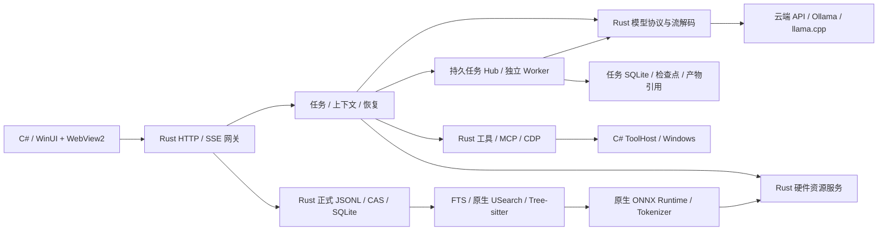

# 独立 Rust 网关

当前版本目标为 1.5.0（2026-10-16），变化与验证范围见[本版说明](../releases/1.5.md)，其他维护入口见[文档索引](../README.md)。

2026-10-18 本地多目录接线：正式项目目录增加 `Mounts[{Id,Name,Path,BindingRevision}]` 与 `DefaultMountId`，`FolderPath` 保留为默认挂载的兼容投影。旧单根目录在读取时派生稳定挂载标识，后续保存固化；聊天、任务和项目记忆仍共享同一个项目身份。HTTP／工具上下文使用小写 `mounts/defaultMountId`，具体文件和终端请求可指定 `mountId`，未指定时使用默认根，绝不授权多个根的共同父目录。任务保存原挂载快照，新增目录不扩大续接任务权限，移除或更换实际使用的根须重新核对。终端会话保留各自的目录，不随默认根切换而改变。

创建项目采用可点外部／Esc 关闭的轻弹层；只有成功保存目录事务后才启动来源准备，取消不创建项目或索引。`GET /api/agent/workspace/files` 按聊天和挂载范围列出目录，右侧文件／终端和模型的 `work.folder.list` 共用同一关系。切换项目通过 `POST /api/retrieval/activate` 发出非阻塞后台提示，普通消息发送不增加这一调用。

发布后端使用独立 Rust 网关，核心不依赖 Node.js。C#/WinUI 与 WebView2 保留；WebView 中的渲染脚本不属于 Node 后端。安装包独立随附固定私有 Node、内置 MCP 依赖和对应浏览器，Node 仅作为外部工具及核验沙箱脚本的运行时；生命周期由 Rust 管理，这不恢复 JS 网关。这里描述源码接线，实际构建与短测记录单独列出，不能将源码存在当作验收通过。



## 职责

未打包便携版本默认将可写数据保存在软件目录下的固定 `Data/`，用户安装的工具、MCP、Skill 与缓存保存在固定 `Extensions/`；模型连接配置位于 `Data/Models/`，桌面及 WebView2 缓存位于 `Data/Desktop/`。正式 AppX/MSIX 包的程序载荷可能只读且会被更新替换，因此继续使用既有 `%LOCALAPPDATA%/KYNXA/Data` 与 `Extensions` 持久目录，以及用户 `.kynxa` 下的存储指针；有效旧指针和旧模型/桌面数据继续保留。重复启动复用这些目录，不创建新的时间戳数据目录。

EXE 安装器采用自包含、无包身份的 WinUI 载荷，安装时将软件、数据、工具位置写入软件旁的 `kynxa-installation.json`；数据和工具默认跟随安装位置，也可分别选择。应用优先解析已选安装配置及有效迁移指针，不把安装器用户引回开发机目录；显式开发隔离环境变量仍优先。旧 AppX/MSIX 启动链继续独立保留，不能把这两种安装形态的路径规则混用。安装和卸载合同见[安装器说明](../../apps/desktop/Build/Installer/README.md)。

用户可在设置中迁移目录。便携版本的软件旁 `storage.json` 与 `extensions.json` 保存选择；相对选择按指针所在目录解析，外部自选目录使用绝对路径。移动完整便携软件文件夹后，默认目录和相对选择按新位置解析，不读取正式包的用户主目录指针。正式包更新不改变已有持久目录与指针。显式 `KYNXA_DATA_HOME`、`KYNXA_MODEL_HOME`、`KYNXA_EXTENSION_HOME` 等环境设置继续优先；独立预览显式设置 `KYNXA_APPLICATION_ROOT` 时使用该副本的便携目录规则。便携软件需放在用户可写的位置。

桌面给子网关传递实际 `KYNXA_STORAGE_POINTER`、`KYNXA_STORAGE_MIGRATION_LOCK`、扩展指针及默认数据/模型/扩展位置，程序和原生依赖仍从载荷根解析。这些默认值不能覆盖有效指针；迁移发布新指针后，运行时重新解析它。显式 Data/Model 环境隔离且未指定扩展指针时，继续忽略正式扩展指针。复用共享网关前核对健康信息中的实际模型目录与扩展目录，缺失或不一致明确失败，不停止其他调用方的服务。

`tools/development/start-clean-desktop.ps1` 保留独立包身份与端口，但数据也使用该副本软件旁的固定目录；仅启动日志和结果文件放入 `artifacts/clean-run/current/`。内置 Node、MCP 依赖和 E5/BGE 权重仍是 `runtime/` 下的随包资源，与用户安装的扩展分开维护。

内置 `document.read` 在文件权限核验后按路径复用现有文档解析器，直接返回 DOCX、PDF 等正文，不以资料入库或语义索引完成为前置条件。字符分页使用 `nextOffset`，PDF 页窗口使用 `nextPage`；版本、原文覆盖及读取成果沿既有工具归档和任务文档记录维护。模型请求已知工具但未加载定义时，任务循环自动经正式 `tool.load` 加载一次，再用原调用 ID 和原参数执行，并保留定义供下一轮使用；未知工具、参数校验和执行审批继续使用原合同。

设置中的本地模型库由 `models/gateway_local_models.rs` 拥有，`/api/local-models` 返回安装目录、固定版本模型目录、下载进度和启用状态；安装、导入、暂停/继续下载、启用、删除与目录变更都由 Rust 接受执行。清单位于统一模型目录下的 `local-models.json`，默认权重目录为其 `Local/`；内部位置保存相对路径，外部引用保留绝对路径。下载保留 `.part`，按固定仓库版本、文件大小和 SHA-256 完成发布，多分片和视觉投影作为同一模型安装。引用导入不会复制原文件，删除引用不删除外部原件；只删除本应用管理的模型文件，不清理聊天、记忆或检索模型。目录迁移与删除先暂停受影响的引擎，有活动生成时返回忙状态。

启用模型会经现有 `ModelConfigStore` 注册 `kynxa-local-<id>` 连接，模型进入原聊天选择器；停用或关闭本地生成总开关只移除自有连接，不更换当前 API 选择或删除权重。`auto`、`on-demand` 和 `preload` 控制当前所选模型的准备，普通 API 对话不启动生成引擎。完整载荷携带固定 llama.cpp CPU/Vulkan 运行时，由 `native-assets/local-generation.json` 维护；Rust 的 `gateway_local_engine.rs` 优先使用随包运行时，端口、参数、资源准入与进程树均由应用管理。闲置时引擎释放权重和 KV，保留可唤醒服务；实际模型请求持有活动计数，应用退出与存储迁移负责暂停下载、关闭进程并释放资源。本地生成开关独立于随包 E5/BGE 检索与重排。

自管模型的正式请求在生成前调用同一已核验进程的 `/v1/chat/completions/input_tokens`，计入实际模板、工具、历史及多模态输入，并按服务报告的实际窗口预留输出空间；计数不执行生成、不记录提示词。超限只收紧本次请求投影的估算预算，复用既有压缩与原文回查，不修改实际窗口或正式消息。普通 API 连接不增加这一预检调用；上游明确报告的上下文、图片或工具语法拒绝按分类恢复，未知拒绝不盲目重发。

根任务、子任务和辅助摘要保留原始回执及未派发/已派发区别。成功响应后重新获得上下文恢复额度；分块摘要需要缩窗时保留两半原文，无法语义压缩的部分保留明确回查入口。已知纯文本自管模型只在请求投影中移除图片，沿用附件文字与 OCR，正式图片附件不删除。

| 负责人 | 生产目录 | 新接线职责 |
|---|---|---|
| A | `apps/agent-core/src/orchestration/`、`resources/`、网关入口及打包 | 请求身份、队列、SSE、任务循环、审批、取消、资源 IPC、集成 |
| B | `apps/desktop/` 中展示与交互文件 | WinUI/WebView 渲染；此次不迁移展示语言 |
| B | `apps/usage-monitor/` | 内置用量统计共用 Core 与默认关闭的 C#/WPF 桌面卡；卡片仅显示主应用快照并保存自己的位置偏好 |
| C | `apps/agent-core/src/models/` | 请求、供应商协议、流、历史配对、压缩、模型配置与原生推理 |
| D | `apps/agent-core/src/tools/`、`apps/tool-host/`、`apps/official-tools/` | 文件、终端、浏览器、MCP、Skill、权限与执行回执 |
| E | `apps/agent-core/src/storage/`、`retrieval/` | 正式数据、分页、记忆、资料、索引、来源版本与后台维护 |

既有纯规则继续复用。新增 `gateway*` 文件是明确列入机器清单的 I/O 接线层；它们负责组合规则和真实执行，不在适配入口重建任务、来源、证据或权限账本。每个接线文件分别声明可调用的领域。纯规则的依赖限制和循环检查继续保留。

## 代码入口与调用关系

同一职责内保留现有文件，执行接线调用纯规则，正式存储通过自己的事务入口更新。以下是当前代码的定位入口；公开 HTTP、SSE、工具名称、JSON 字段和数据版本不因内部命名或排版调整而变化。

| 层次 | 主要入口 | 调用与所有权 |
|---|---|---|
| 启动与传输 | `src/bin/kynxa-gateway.rs`、`src/gateway.rs` | 启动配置、HTTP/SSE 和取消；将业务请求交给运行时与所属领域 |
| 请求生命周期 | `src/orchestration/gateway_runtime.rs` | 请求身份、排队、审批和当前工作快照；持有请求运行状态 |
| 模型与工具循环 | `src/orchestration/gateway_loop.rs` | 组装当前上下文，调用模型和工具；保存真实回执后推进任务与证据状态 |
| 任务状态与验证 | `src/orchestration/task.rs`、`progress.rs` | 任务续接、公开正文投影和版本关联的执行核验；不自行发起模型、文件或终端操作 |
| 持久任务与子代理 | `src/orchestration/gateway_task_hub.rs`、`gateway_task_worker.rs` → `src/storage/task_repository.rs` | 稳定任务身份、独立上下文、事件与检查点、共享预算和恢复；工具回执仍引用原正式归档 |
| 模型接入 | `src/models/gateway*.rs` | 配置、供应商协议、流解析、上下文压缩和推理；复用同领域的确定性规则 |
| 工具发现与策略 | `src/tools/gateway.rs`、`policy.rs`、`system_prompt.rs` | 发现、加载、权限和能力说明；把获准的动作交给对应执行适配器 |
| 本机工具执行 | `src/tools/gateway_process.rs` → `apps/tool-host/` | Rust 拥有进程与 IPC 生命周期，C# 执行 Windows 操作；回执保留真实输出与身份 |
| MCP、浏览器与网页 | `src/tools/gateway_mcp.rs`、`gateway_browser.rs`、`gateway_web.rs`、`gateway_web_proxy.rs` | 各自拥有协议连接、调用、取消和清理；MCP 额度由 `gateway_mcp_budget.rs` 提供 |
| 历史和资料取证 | `src/retrieval/gateway*.rs` | 解析授权范围、检索与回源；`gateway_history.rs` 区分当前聊天和显式工作历史 |
| 索引发布与查询 | `src/retrieval/gateway_index.rs` → `src/storage/sqlite_*.rs` | 派生签名、索引版本、向量与 ANN；复用存储事务和连接所有者 |
| 正式存储 | `src/storage/gateway.rs`、`conversation_*.rs`、`catalog*.rs` | 消息、目录、原文和工具归档的版本、锁与事务；上下文缓存和界面投影不是独立写入者 |
| 硬件准入 | `src/resources/gateway.rs` → `apps/resource-service/` | 实际资源观测、租约和准入；工具、模型与后台索引共用资源边界 |

表内 `src/` 相对 `apps/agent-core/`；具体跨域许可与执行模块登记仍以 `docs/team/module-ownership.json` 为准。`src/lib.rs` 提供共享原生操作合同和范围状态会话，HTTP 入口继续复用这些合同，不另建一套业务规则。

修改时先定位调用入口和状态所有者，再调整所属模块内部。新增私有辅助函数应表达可复用的实际步骤；原文哈希、JSON 字段顺序、取消后的已执行回执和作用域核验仍需按既有合同处理。注释说明职责、原因和生命周期，保持简明中英两层，不逐行复述代码。

## 请求与数据

- 桌面默认连接 `127.0.0.1:5218` 的 Rust 网关，可通过配置指定其他地址或端口；沿用模型、聊天、记忆、工具和检索 HTTP 合同。健康检查要求真实 `runtime: rust`，不能接到旧 Node 服务后仍称新网关已启动。
- 模型列表对旧连接缺省或 `null` 的上下文字段投影整数默认值，兼容桌面的非空整数合同；原始连接文件、密钥和已保存的有效额度不改写。此公共兼容值不作为模型实际能力证明，运行窗口仍经过自动能力与本机观察核验。
- 请求 ID 与用户消息 ID 不同；相同请求身份不得用于不同内容。每个聊天串行推进，其他聊天可以并行。发送、模型就绪、生成和结束分别发事件。
- SSE 增量正文原位追加，重连缓存按条数和字节有界。正式消息、模型步骤及工具归档仍是恢复依据，缓存不能替代正式日志。
- 桌面仅首次通过 POST 提交消息；流解析失败或提前结束时，按原 conversationId/requestId 查询 `GET /api/chat/status`，再通过 `GET /api/chat/stream` 重新观察原请求。已完成回复使用正式结果补齐；恢复快照绝对替换内容，不能重复追加，也不能重新执行用户消息。普通聊天不增加状态查询。
- 内部模型步骤、资源、队列和暂时落盘故障保留原请求，退避等待后核验既有回执再续接；未确认写操作不自动重放。完成标记的交付须等正式任务落盘；用户停止可退出等待。连接、认证与账户额度故障分别保留真实诊断，不把普通限流或参数兼容拒绝误当用户取消。
- 已接受请求先持久登记任务，再确认 SSE；界面断线仅停止观察，明确停止通过原取消入口落盘。子任务进度和审批使用独立事件，不占主回复工具序号；任务侧栏按游标分页，暂停与取消有版本校验。详见 [持久任务合同](durable-tasks.md)。
- 主请求、子代理和上下文语义压缩的实际模型传输共用准入与父子预算预约。API 并发由 4 路起步，根据有效完成和限流调整至 2～8 路，保留主请求槽位；本地同端点串行，实际硬件租约独立生效。等待子任务和人类审批不占模型生成槽位，也不冒充实际执行耗时。
- 正式目录、消息日志及迁移继续使用原始 JSON、稳定 ID、CAS 和已有事务协议。公共历史分页保持原始 UTF-16 转义，私有供应商续接不会进入公共正文。
- 目录锁保护身份快照和正式提交；历史正文、偏移建索引和记忆来源读取在锁外进行。记忆校验按来源聊天合并引用消息，只解码所需的最新用户记录；返回或发布前重新核验归属、记忆文档版本及日志快照。已有长日志不会因逐条记忆校验而反复解码所有旧助手快照。
- 私有续接复用必须核对供应商、模型、连接身份、原始前缀、轮次、归档所属请求和内容摘要。核对失败保留公开的调用/结果配对，不能由模型文字批准续接身份。
- 主聊天、子任务与失败兜底回复的系统提示携带本次已解析的连接 ID、模型 ID、协议及端点主机名，区分 KYNXA 应用身份与配置模型。此信息计入上下文预算并在压缩后保留；历史回复、摘要和已确认记忆中的身份说法不能覆盖当前配置。提示不包含连接密钥、URL 用户信息、路径或查询参数，也不把代理或别名配置当成真实上游模型的独立认证。
- 参数、工具流或供应商调用失败采取有限步骤恢复；成功写入不重做。派发结果未知先读取实际状态，自有终端注册表可证明派发，但不能证明任务或测试成功。
- 压缩采用现有原生计划、语义摘要与归档检查点。语义摘要失败仍保留原文入口；它不删除正式历史，也不释放副作用保护。
- 文档已读范围以当前来源版本的真实读取回执为准；摘要处理窗口只描述归档摘录，不变成原文未读事项。恢复保留已加载工具顺序、内容结论与成功产物路径；内部上下文整理不登记为结果未知的外部副作用。
- 已核验产物获得一轮正常额度的正文综合机会，暂不附工具定义；模型仍可指出具体剩余工作并继续执行。工具额度用完也先用现有证据完成正文答复。OpenAI 兼容的纯正文请求显式使用 `tool_choice: none`，本轮指导不要求或模拟工具调用。

旧聊天选中后立即使用底部输入布局。冷聊天先请求最近 4 条、约 256 KiB 的小页，再后台补齐最近 40 条、约 1 MiB 的普通页；单条原文不被页面额度截断。切回已有缓存时直接显示，后台刷新沿原有滚动和选择保护处理。首屏只投影最近内容，长回复先显示安全转义的尾部，完整 Markdown 分批后台解析，DOM 按视口挂载；正式消息、完整复制和更早历史的分页入口保持不变。

历史分页前后只读取受检目录快照、复核当前聊天归属与日志版本；待恢复的目录事务仍进入原有恢复路径。读取几条消息不重新遍历全部聊天目录和项目清单。完整目录操作继续执行正式布局检查，当前聊天的受检文件打开与快照校验保留。

## 右侧文件与网页工作区

右栏复用 `ConversationWorkTabs`，任务区默认折叠为 28 DIP 标题，用户展开后才轮询进度，整个展开区域仍受可用高度限制；收起不暂停后端任务。下方标签与预览使用剩余空间，标签文件名固定 190 DIP，名称及关闭按钮共用同色背景，高度 26 DIP。截图、真实成功文件回执、任务产物与文件选择器共用标签入口；同一路径更新同一标签，关闭视图不删除文件或取消任务。模型可通过 `artifact.open` 选择展示现有文件或 HTTP(S) 网页，并提供标题；文件生成和命名仍通过正式文件工具完成，不从助手正文猜测产物。

`POST /agent/workspace/preview`（同义 `/api/agent/workspace/preview`）按当前 conversationId 的真实工作范围读取预览；`GET /agent/workspace/content` 返回带版本校验的 PDF、图片或受限 HTML 原始内容并支持 Range。系统文件选择器可为当前聊天授予单文件预览许可，该许可不扩大模型工具权限，也不放开正式 Data。Markdown、公式和 Mermaid 复用离线资源；文本按 UTF-16 分页；DOC/DOCX/PPT/PPTX 等由私有 LibreOffice 转换成缓存 PDF。完整资源构建准备 `runtime/office/`；旧离线资源缺少转换器或转换失败时显示提取正文与原因，不阻断对话。

`ConversationDocumentPanel` 按需建立并保留已打开文档的 WebView、DOM 与阅读位置，按硬件档位缓存 4／8／12 个视图，闲置视图降低内存目标并尝试挂起；另保留最多 64 份、合计 3200 万字符的解析结果。每份文件拥有独立的读取与渲染任务，切换标签后继续完成并更新其自身缓存，不把晚到结果写到新选中的文件；关闭、刷新和删除所属聊天时取消对应任务。切换缓存内标签不重复读取或渲染，显式刷新重新获取内容，超出容量淘汰最久未用视图。Markdown、SVG、隔离 HTML 和代码预览各用正确的显示类型；普通文本使用中英界面字体，代码复用统一高亮组件和等宽字体。Rust 执行读取、解析和转换，C# 管理标签及生命周期，WebView JavaScript 只做文档渲染。

外站网页通过 `POST /api/agent/workspace/chrome` 仅按需启动随包 Chromium，不探测或回退本机浏览器。Rust 统一持有共享进程及 `Data/Browser/Workspace` 持久目录，登录状态按应用跨聊天、工作和重启复用；每个聊天仍持有独立的 target/窗口及权限范围。同一聊天相同网址复用已有会话，最后一个网页关闭后释放自有进程并保留登录数据。C# 在网页内容行建立原生子窗口宿主，Chrome 使用 `WS_CHILD + SetParent` 接入；宿主按 XAML 视口定位，父子窗口硬裁剪，任务区与文件标签不在网页宿主内。不能把顶层 owner 配合 region 当作嵌入，也不能只凭 region 数值声称没有遮挡。同一进程下按回执标题与实际边界映射窗口，不按 PID 随意选择窗口。固定动作 `/chrome/action` 提供导航、前后退、刷新、状态、关闭及用户显式触发的全局 `clearSiteData`；关闭标签、删除聊天与普通退出不清除登录目录。按内存档位保留 2–4 个网页视图。聊天、Markdown 与本地 HTML 仍用独立 WebView2，不进入网站自动化范围。

右侧主页提供文件、未提交变更与终端入口。主页和浏览器地址栏共用地址解析：网址直接访问，普通关键词进入 Google 搜索。启动恢复历史网页只恢复标签信息，用户激活或当前任务明确请求打开时才加载；浏览器类 MCP 不参与后台预热，其他可信服务沿用现有策略。普通打开网站默认进入右栏；只有明确要求本机或系统浏览器时才走外部应用，个人浏览器配置不被借用。变更通过 `GET /api/agent/workspace/changes` 在当前授权目录查询 Git 已暂存、未暂存内容及未跟踪文件名。

终端直接显示在右侧 `terminal` 标签中，不弹出 PowerShell 或 Windows Terminal 窗口。`ConversationWorkspaceTerminal` 使用随包 xterm.js 展示真实 ConPTY 的 VT 输出并回传键盘、粘贴及窗口尺寸；它的本地 WebView 桥只接受终端页面消息，与聊天、文档及外站浏览器隔离。Rust `tools/gateway_workspace_terminal.rs` 持有 ConPTY、shell 和进程树；`POST /api/agent/workspace/terminal/open` 从当前聊天的真实工作归属解析启动目录，`/terminal/action` 提供 read、write、resize、close。模型通过 `terminal.workspace.open/list/read/write/close` 操作同一真实会话，`workspace_terminal_open` 只让界面挂接既有 sessionId，不再创建第二个 shell；模型也可列出、读取和向用户已开的当前聊天终端输入命令。输入接受与命令完成分开，界面和模型使用独立输出游标。切换标签或收起侧栏保留 shell 与输出，关闭终端标签、删除所属聊天或退出软件释放会话和进程树；输出缓存有界。此入口遵守宿主终端的权限与审批，不改变 `terminal.host.*` 的现有合同。

终端已建立会话后的按键、输出和尺寸变更只复核现有会话及当前聊天归属，不重新准备整份工具配置、检索与目录布局；目录文件身份变化或待恢复事务仍走正式恢复路径。输出长轮询与输入写入分开持锁，等待输出不能阻止用户输入。

同一聊天可以创建多个终端。每个标签持有独立的 tab key、ConPTY 会话和 WebView，终端标题行的“+”创建新标签；关闭一个只释放对应会话，切换或返回聊天复用仍存在的终端。删除聊天与软件退出继续关闭全部所属终端。

聊天首屏优先显示最近消息，历史文件回执的 JSON 解析与资源投影在后台执行，右侧截图来源扫描通过界面低优先级队列合并。公式脚本在实际出现公式时才加载；未加载时先保留原文，加载完成补齐排版并保持阅读位置。纯文字聊天不等待公式库就绪。

26 DIP 文件标签栏隐藏系统横向滚动条，溢出时显示紧凑的左右导航，保留滚轮、触控板和选中标签进入可见区；未溢出时导航不占宽。标签刷新等待自然布局后恢复横向位置，不同步强制整个界面布局。

工作区文件预览、内容读取与网页首次打开使用只含当前范围、文件授权和随包资源路径的轻量展示上下文，不准备模型工具、MCP 与检索配置。Office 确需正文提取时再读取正式解析配置。浏览器收到打开回执后先挂载窗口，后续状态读取继续更新真实尺寸。Rust HTTP 使用异步调度，历史及文件阻塞操作进入阻塞线程池，索引维护使用后台线程；C# 管理界面和生命周期，WebView 管理排版，前台请求不以完整后台工具准备为前置。

随包 Chromium 仍开启 Windows 沙箱。构建准备及首次使用时，只为清单指定的浏览器程序目录补齐 AppContainer 组的读取、执行权限；ZIP 解压和移动目录后也走同一规则，不放宽 Data、个人浏览器配置或用户工具目录权限。浏览器网页宿主只露出真实内容区域，Chrome 重设标题栏或系统边框后会重新校正。

网页自己的新窗口保留真实 `opener` 和页面状态，由 Rust 跟踪同一自有 profile 的页面链，C# 按自有进程身份映射窗口并挂入同一视口宿主；返回和前进兼顾页内历史与页面链。软件失焦时保留网页，原生父窗口负责移动、层级与裁剪，不设全局置顶；最小化、收起侧栏、切换标签及模态弹层按生命周期隐藏。已有网页状态和导航只复核当前聊天范围，不重读整份工具及检索配置；删除聊天后仍可按匹配的聊天、会话身份关闭自有进程。退出时网页与终端共用清理等待预算。

`browser.snapshot` 在浏览器内用固定 Mozilla Readability 解析文档副本，保留标题、来源链接、表格及正文；页面控件继续使用原主文档顺序，同时返回 selector、role 和可视区域坐标。补充同源 iframe 与开放 Shadow DOM 的只读文字，明确跨域和数量覆盖边界；提取不会修改真实页面或伪造可操作引用。应用内 `web-research` Skill 按这些真实字段指导搜索、抓取与浏览器读取，截图沿用原多模态工具入口。

Google 异常流量页及已识别的 Cloudflare 人机验证页返回明确的人工验证状态，不能作为正常资料证据。右栏保留页面供用户手动验证；Google 查询可由用户点击切换到备用搜索源，不在用户验证期间自动刷新或跳转。模型遵循 `web-research` 的验证交接与备用检索指引，不求解验证码或循环读取拦截页。

网页输入由 `ConversationChromeView.Input.cs` 在 XAML 视口接收，再按真实页面 HWND 的客户区坐标转交鼠标、拖动与滚轮；输入法使用原生 TextBox 接收提交文字，键消息与文字分开派发，避免重复字符。该接线仅作用于当前网页，不安装全局输入钩子。Chrome 提示栏在窄窗口换行后，按最大可见页面 HWND 的原生边界重新计算装饰偏移，排除微小输入法辅助窗口。后台绘制关闭 Chrome 对独立顶层窗口的遮挡判断；宿主仍随最小化、网页标签切换及退出隐藏或释放，不将应用设为置顶。

网页 `artifact.open(url)` 取得真实右栏会话及标签身份后才返回，桌面收到实时完成回执即交给右栏并激活，不能等回复结束后再把它误当成历史标签；同一回执只处理一次。当前运行中的打开意图跨布局刷新和聊天切换保留，软件启动恢复的历史标签仍按需加载。首个地址尚未提交时保留真实 `url`、导航状态及 `requestedUrl`，展示路径可用请求网址挂载正在加载的页面。桌面复用该网址的现有会话，不重复导航；`browser.tabs` 可省略会话 ID，仅发现本聊天已登记会话。模型提示从同一运行时读取已有网页身份，不额外访问网页；这些线索不等于页面内容证据。正文仍通过 `browser.snapshot` 观察。原生工具调度及 DevTools 握手在异步职责边界装箱，避免调试构建叠加大型 Future 导致线程栈溢出。

工具能力与经验由 `tools/gateway_tool_memory.rs` 接线、`storage/tool_memory.rs` 原子保存到配置 Data 下的 `Agent/tool-memory.json`，跨聊天和重启复用已核验的静态声明、来源配置指纹及成功/失败、耗时汇总。配置读取边界首次加载，未变化时复用内存；更新、禁用、删除或撤销信任时清理对应能力与经验，真实 MCP 目录刷新同步撤下旧工具，schema 改变重置对应经验。缓存不含调用参数、结果、凭据、用户原文或浏览器/进程身份，也不属于个人长期记忆。

初选及 `tool.search` 仍先做原有本地相关性匹配，经验只打破同分，不增加候选或模型、嵌入、检索调用。普通聊天不查工具记忆文件、不调用额外工具；能力发现不启动或等待 MCP，缓存也不表示服务已就绪。真正执行仍按当前授权、配置和握手返回的实际 schema 校验；审批、等待、取消和未知结果不学习为成功。成功或失败的已结算调用更新衍生经验，记忆写入失败不改变正式工具结果。

## 用户消息附件

输入区支持文件选择、拖入和剪贴板图片，发送前仅保存本机草稿。发送时先显示用户消息，再通过 `POST /api/conversations/{conversationId}/attachments/import` 保存原件；正式消息的 `Attachments` 仅包含稳定 ID、名称、类型和大小。原件及解析缓存属于对应聊天目录，随聊天移动和删除，不自动进入全局记忆或共享索引。

消息范围内的附件接口提供原始字节、图片及 UTF-16 解析分页。DOCX/PDF/PPT/文本与图片 OCR 复用 Rust 现有解析器；当前模型轮按上下文预算接收相关摘录，图片沿已有多模态协议发送，模型明确拒绝图片时保留文本与 `attachment.read` 回读路径继续。用户正文不改写成解析结果，队列与引导沿同一附件身份续接。用户消息上方显示图片和文档卡片，点击后在右侧打开，历史图片通过只允许当前消息附件的原生代理加载。

## 内置用量统计与可选桌面卡

`Services/Integration/UsageMonitorService.cs` 在 WinUI 主程序运行期间维护唯一的模型用量展示累计。输入框底栏右侧固定显示本次运行的 Token 消耗与缓存命中率，点击展开输入、输出和缓存命中明细；设置页可开启默认关闭的桌面悬浮统计卡。卡片不包含人物或消耗阈值，沿用宿主主题与语言，支持拖动、折叠、恢复右下角和置顶。

桌面启动原生网关时设置 `KYNXA_USAGE_LOG`，默认路径由 `StoragePaths.DesktopDirectory/UsageMonitor/usage.jsonl` 计算。手动网关可显式配置绝对路径；未设置则不记录。`GET /health.usageTelemetry` 返回 `{protocol:1, enabled, logPath}`，主应用从健康响应取得实际日志位置；已有旧网关需要在其任务结束后更新并重启。主程序启动时从日志末尾开始收集新调用，关闭或晚开启悬浮卡不改变统计周期，二者始终显示同一份运行期快照。

`UsageMonitorService.Floating.cs` 启动随包 `UsageMonitor/KYNXA.UsageMonitor.exe`，只通过继承的私有 stdin 发送有界 JSON 快照。WPF 完成真实窗口呈现后发送 `KYNXA_USAGE_MONITOR_READY_V1`；启动或互斥失败发送 `KYNXA_USAGE_MONITOR_ERROR_V1`。卡片不自行读取生产用量日志，不维护第二个累计，不读取 API Key、请求模型或写正式聊天/记忆。准确宿主进程退出、控制 stdin EOF 或显式关闭命令均结束卡片生命周期；按设置目录互斥，不按进程名终止其他实例。

`models/gateway_usage.rs` 通过有界队列异步记录 `schemaVersion:1`、`event:call_completed` JSONL，每个已派发模型调用独立 `callId`，保留实际用量与状态。没有供应商用量时字段为 `null`，真实零值保持为零；错误或取消不抹去此前收到的用量。日志不包含提示词、回复、凭据、请求头或上游地址。`unrecordedCalls` 是当前网关进程内已确认入队/写入失败的累计数，跨进程启动归零；强制退出时未写出的队列记录无法证明完整。

输入与输出均已知时可以相加推导 Token 消耗，输入、输出另保留各自完整性覆盖；缓存命中率按命中输入 token / 对应输入 token 加权。未知、缺失、字段冲突或采集丢失保留不完整提示，不能显示成零命中。数字只随真实调用用量快照变化而轻微滚动，不把字符长度当成供应商 token，也不声称逐 token 的实时计费。开发回放必须显式使用 `--replay` 并在窗口标注“演示 / 回放”，生产悬浮卡不接受用量日志参数。完整使用、合同与上游 MIT 归属见 [用量统计模块](../../apps/usage-monitor/README.md)。

## 检索与模型资源

- 路径查找、受限文本搜索和回源读取独立于全量语义索引。挂载工作和正式资料由后台维护；前台不等待全部向量生成。
- 词法、向量、ANN、候选复核及版本检查使用现有 Rust 存储合同。原生 USearch 接管图索引，不经 Node 搬运整批向量。
- `auto` 的大集合缺图时先返回可用的词法证据，分片规划、磁盘图装载和构图由既有后台维护线程消费 ANN 队列；相同图任务合并，查询取消不取消共享准备。返回的 `annBackground` 区分准备中、资源受限和就绪，准备完成后才使用完整分片集合。后台沿用原维护线程的取消与退出等待，数据迁移不会越过仍在写入的图任务。
- 图身份包含数据库、索引版本、范围代次、向量空间及构图参数；更新后旧图不能冒充新版本，重启后可复用相同身份的磁盘图。分页按分块 ID 读取所选空间的向量，不在每页重排全部候选；图质量参数仍采用既有默认值，重排仍按用户配置启用。
- 默认自适应模式以四个驻留分片起步，完整集合需要更多分片时可在现有十六片上限内扩大，每片继续申请硬件资源租约。用户指定的其他驻留上限或关闭自适应时不自动扩大；无法容纳完整集合时返回资源受限状态并沿用队列退避，不反复构建、驱逐同一组图。成功准备后由现有磁盘缓存预算清理旧图。
- E5 与重排使用固定模型资产、真实 tokenizer、ONNX Runtime、批量与取消合同。CPU/DML 的模型空间按兼容资格区分；不能通过放宽空间校验实现假回退。
- Windows 运行库复用旧推理链实际使用的 ONNX Runtime 1.21 字节。桌面其他依赖中的 1.24 文件不能替代这项固定资产。真实向量对照是单独的短测。
- 前台资源等待可请求回收本程序闲置 CPU/GPU 推理会话。只有会话实际卸载和硬件服务确认释放后才撤销预约；正在执行的会话不能提前释放。
- 外部 Ollama 仅观察并协调待增长资源，不停止或卸载用户自行启动的模型。未知占用保持不确定性，不以整份已驻留权重再次预留。
- 上下文依据已核验官方能力和实际本地观察决定，旧连接字段仅兼容保存。未知 API 部署不能预知全部输入/输出限制；已识别 HTTP 400 拒绝按当前请求的有界恢复处理，不由模型名称或配置值擅自授额。
- 图构建、文件解析、索引事务和推理放在后台/工作线程；HTTP 和 UI 不承载同步全仓扫描。

## 发布与启动

受管 GGUF 的就绪状态同时绑定所选文件、请求端点与本程序持有的 llama.cpp 子进程：首次装载和唤醒核对固定运行时 `/props.model_path`、真实端口所有者，以及 GGUF／分片／视觉投影的文件身份。暖复用仅查轻量文件身份和原生进程／端口状态，不重复 HTTP 或读取大权重。身份检查失败清除旧就绪结果。`modelIdentityVerified`、`loadedModelPath`、`processId`、`baseUrl` 与工具模板的 `supportsTools`／`toolCallingMode`／`toolCapabilityState` 分别传播到准备结果和设置页；未知工具能力不采用目录的乐观默认。显式 Jinja 和运行模板能力检测不代表模型生成质量已经全面验收。主聊天、恢复请求及子任务共享这一能力判定。

本地预载已经派发后，取消或准备截止不能证明外部 Ollama 已停止装载。未知结果保留预约并进行最多一分钟的独立驻留核验；确认装载完成或新鲜观测表明目标模型已驻留后才核销。仍无法确认时沿现有资源服务进入过期隔离，后续新鲜驻留观测可以核销，不重复派发同一未确认预载。llama.cpp 的服务健康不能证明权重已加载，必须同时匹配配置模型与明确的驻留观测。

开发启动保留：

```powershell
dotnet run --project apps/desktop/KYNXA.Desktop.csproj -p:Platform=x64
```

构建机使用 `apps/desktop/Build/prepare-native-runtime.ps1` 准备原生 EXE、固定 DLL、模型资产、私有 MCP 运行时和许可证；用户不需要自行安装 Cargo、Rust 或 Node。生产网关为 `runtime/agent/kynxa-gateway.exe`，硬件服务为 `runtime/resource/kynxa-resource-service.exe`。模型、SQLite 向量及 VC/DML 运行库位于随包清单中。

`node server.mjs` 与 `npm start` 不再是运行入口；保留这两个命令会重新引入 Node。[start-native-gateway.ps1](../../tools/development/start-native-gateway.ps1) 直接调用已准备的随包原生网关；手动测试须指定独立 DataHome、ModelHome、ExtensionHome 和端口。已经运行的旧 Node 服务应在任务结束后关闭，再使用新版本；新服务不会默认接管其他进程的任务或数据所有权。

外部 Node MCP 使用私有 `runtime/mcp/node/node.exe` 或用户明确指定的已安装运行时，与已安装入口脚本的绝对路径；运行路径不通过 `npm`/`npx` 下载或更新包，缺依赖只影响对应服务。固定官方预设经随包清单转为私有路径，并为固定受信默认项填写 `trusted: true`，用户覆盖和禁用选择继续保留；陌生仓库命令不因此获得信任。后台预热要求正式信任、明确的已存在 `cwd` 和脚本。`backgroundTask` 声明需持续运行的服务，`prewarmPriority` 为 0～1000 的预热排序值；共享配置合同保留这些字段。

私有运行时由 `prepare-mcp-runtime.ps1` 在构建机准备：Node 24.14.0 官方归档和 EXE 固定 SHA-256，五个 MCP 包固定 package-lock，Chromium 与 Playwright 版本及 EXE SHA 对齐，完整原始许可证和安装后文件校验随包。`runtime/mcp/manifest.json` 只包含小型入口元信息，软件启动不读整个 node_modules、不安装依赖。Playwright/Chrome DevTools 使用独立随包 Chromium；Context7 默认使用官方 HTTP，保留本地入口。Brave 需要 API Key、DBHub 需要明确数据库配置，其他未随附 MCP 仍需自己的运行时和依赖；不能宣传所有扩展离线免配置。

路径初始化后、主窗口构造前，独立后台任务把保存的 `providerId` / `modelId` 提交到 `POST /api/models/preparation`；用户切换模型也立即提交新选择。后端从正式连接读取凭据，立即返回 202，模型完成状态通过 `GET /api/models/preparation` 查询。准备不加入窗口、项目加载或发送消息的就绪等待。当前选择优先准备，其他 API 连接最多两路检查并复用已有 HTTP/TLS 池；连接池空闲保留五分钟，不发送收费的测试生成。API 可连接、模型已加载与推理已验证分别记录。未提供模型列表的 API 仍返回未知模型能力；404/405 响应仅在短时限内完整消费后标记连接已预备，不能把它当成生成成功或失败。本地优先准备当前选择；Ollama 仅对已经安装的模型经资源准入后使用空请求预加载，再刷新运行状态，接口依据 [Ollama 官方说明](https://github.com/ollama/ollama/blob/main/docs/api.md)。其他本地连接检查实际接口与驻留，不同时加载全部权重。没有外部运行器配置时明确报告服务未运行，不下载模型、不启动猜测出的程序、不停止用户管理的进程。

发送消息先显示用户正文与等待占位，再由正式目录事务保存工作归属和新用户消息。已在当前目录登记、位置不变且没有提交用户消息的聊天只更新元信息，不为它们读取历史消息身份；新聊天、提交用户消息、移动或从回收区恢复仍读取对应日志并核对角色、身份和版本。空 `Messages` 表示本次没有提交正文，不清空已有历史。无关历史损坏不会阻断另一聊天的元信息或消息提交，显式读取损坏历史仍报告错误。窗口“用时”保持模型阶段口径；正式 `ToolRun.diagnostics.requestTiming` 分开记录网关接受请求到模型阶段、模型循环、接受到最终保存前的耗时，明确不含桌面目录保存与最终持久化，不能把它当作点击发送到界面完成的总耗时。

首次生成前的独立准备并行等待：模型配置与工具上下文、工具配置与检索设置、摘要与已确认记忆及本地模型状态分别复用同一次请求范围；自动证据检索与历史协议投影/当前附件解析并行。普通聊天先用原有纯意图规则跳过自动检索，不创建检索工作线程或启动嵌入；已确认记忆仍正常注入。生成仍等待所需证据和附件齐备，并先保存引用。检索失败改变 system 时按最终前缀重新核对历史私有续传，避免复用不匹配的前缀；不缩减检索质量、范围或上下文预算。`preparationStages` 分别记录检索、历史/附件及合计墙钟耗时，重叠分支不能相加当成总等待。

核心健康响应先返回，模型连接准备立即排入后台，不再等待固定延迟或桌面选择通知；尚未选中的本地模型只观察，不加载权重。模型准备优先，随后延迟三秒受控预热已安装、受信任的 MCP。启动、跨服务调用和空闲驻留按真实资源快照约每五秒更新；16 GiB／8 逻辑核参考为 4 路启动、16 路跨服务调用、512 MiB 空闲缓存，32 GiB 为 6／32／1 GiB，实际仍受当前余量与 32 连接上限约束。单服务管道保持串行；前台优先，同一服务启动单飞，后台拿不到服务锁立即让出启动额度。收缩等待运行中调用归还额度，不强取消有效协议。Windows Job 自有进程树通过已核验 PID 和句柄采集私有内存、工作集，未知单独报告；活跃调用、订阅和后台任务不按空闲回收。常驻占用已反映在系统可用量中，准入只预约待执行缓冲和 CPU，不能重复扣进程驻留。缺依赖仅使该服务失败，启动不下载包；主动停止、信任撤销和配置代次检查继续生效。当前策略基于资源，尚无吞吐学习；先启动后登记 Job 的极早派生窗口仍存在，不将隔离或清理夸大为绝对保证。

纯 Markdown Skill、资源读取、配置及原生工具继续保留；JS/MJS/CJS 执行型 Skill 使用随包私有 Node 和 C# ToolHost 的 AppContainer，按只读文件清单及 SHA 核验后执行，工作输出仅写隔离副本；不启动宿主脚本或临时下载语言运行时，其他语言不在本轮支持范围内。MCP 状态通知是已定义的非终态 SSE 事件；桌面继续接收正文。未加载工具返回发现/加载入口，不冒充没有实现。工具、Skill、MCP、上下文整理的内部失败保留回执并有限恢复，仍受阻时完成正常进展答复，任务结果保持部分完成或未核验；用户取消、模型配置、额度和外部网络错误仍如实报告。

旧后端源码在删除前保存于本次开发备份中。历史 Node 测试成绩和此前小样本性能不等于新完整 Rust 网关的验证结果。本次只报告实际重新执行的编译、聚焦回归、真实小批量嵌入和消息短测，不宣称大型仓库质量、整套模型任务或界面操作已重新验收。
