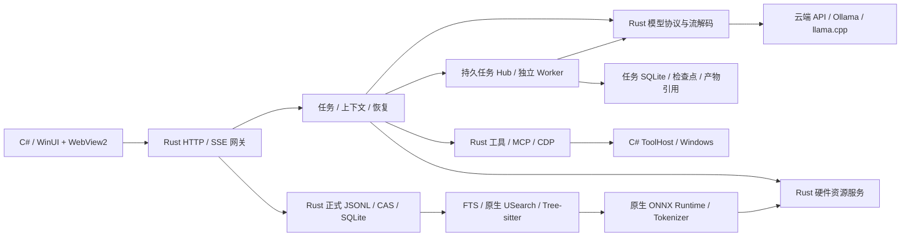

# 独立 Rust 网关

## 本地图片与后台视觉分析

`image.read` 在现有文件授权范围内读取 PNG、JPEG、GIF 或 WebP，将真实像素作为模型的多模态输入，`artifact.open` 仍只负责展示。可以指定路径、挂载、版本哈希、原图裁剪区域和输出尺寸；目录查找继续使用原有文件工具，不默认扫描整个文件夹。读取限制为源文件 32 MiB、6400 万像素，输出长边默认 2048、最多 4096；解码并发为 2，资源不足排队且可取消。原文件不修改，回执分别记录来源和实际发送图片的版本。

`browser.open(url)` 默认后台分析：同地址页面可复用，其他地址使用独立页面，不导航或抢占用户正在查看的页面；明确展示时使用 `presentation=workspace` 或 `artifact.open`。DOM 能回答的问题先读 DOM。普通启动软件、保存文件的成功回执足以确认操作，不追加视觉验收。视觉用于当前确有画面问题、用户要求外观质量，或 DOM 无法解释的情况；复用未变化的观察，最新停止与交付指令优先。

截图采集与分析不自动展示、选择或切换右侧栏目。有价值的总结报告、关键结果截图和用户要求展示的内容可通过 `artifact.open(resultId)` 作为交付展示，复用同一原图与标签；保留与展示分别处理，永久保留本身不触发展示。

新产生的模型图片载荷与不可变执行回执分开保存。默认临时保留 24 小时，网关每 10 分钟在后台有界清理；活动读取可使用最长 30 分钟的短租约。截图可指定 `retention=permanent` 和非空 `retentionReason`；`image.retain(resultId,reason)` 也可保留已有结果，适用于用户要求或重要结论的关键依据。清理仅删除本程序保存的图片副本，不删除用户原图、文字结论、任务进度或成功回执。根、子任务检查点保存稳定引用并在验证身份和哈希后恢复图片；已过期的图片改为带原哈希的说明，不能假装仍能看见，也不能因此重做成功操作。旧版内嵌图片归档保持原字节，不进行破坏哈希的原地迁移。

视觉输入沿原模型协议及用量结算派发；能力取决于实际配置的模型。不凭模型名称推定视觉能力，不虚构辅助视觉模型或把图片尺寸统计冒充画面理解。

## 2026-10-21：模型与检索缓存（本地实现，未发布）

模型请求把固定行为、当前连接身份、有效权限规则与已确认记忆放在系统指令中；时间、目录和 Skill 目录等运行观测使用下述追加快照，不再每轮改写历史之前的动态系统段。记忆撤销仍即时重新投影。工具选择和裁剪保留相关性顺序，发送声明按 wireName 排序；对象字段规范排序，历史角色、工具配对、内容数组和签名字符串不变，不为命中填充上下文。根任务与子任务共用供应商适配，缓存范围键取稳定数据／项目／聊天范围的摘要，不含逐轮预约或请求 ID，不外发磁盘路径。

只有已识别的官方 HTTPS 端点及已知模型／协议使用专用控制：OpenAI Responses 保留原 `instructions` 与 `input` 结构，以 implicit 模式和稳定范围键复用缓存，不把系统指令改投影为 developer 消息；Anthropic 为工具、稳定系统块及滚动历史最多新增三个合法锚点，已有控制完整保留；DeepSeek 及现有 Gemini OpenAI 兼容入口只识别自动缓存，不创建付费缓存对象。未知代理及本地接口不注入这些字段。用量仍来自原预约结算，累计输入避免重复加算缓存；读取、创建和非缓存数值分别保存，缺失保持未知，旧结算指纹兼容。网关观测明确放在原预约的 `providerUsage.clientMetrics`，与供应商计数分开：策略诊断不含请求正文／密钥；`firstVisibleTextMs` 从真实 HTTP 派发到首段非空正文，不包含思考或纯工具事件，也不代表桌面首绘。取消或断流保留已观测值；非流式与未收到正文保持未知。统计 API 只聚合已知值并报告覆盖数，不为计量重发请求。

检索保留原 E5 向量空间、索引和历史数据；移除随包 BGE 的资产、下载、神经重排调用和专属分数缓存。自然语言走词法与 E5 的名次 RRF（rrfK 默认 60，开发调参范围 20～100），仅用精确路径、完整符号名、标题命中作少量结构加权，合并一致的相邻片段、去重并限制前十条同一文档最多三条。明确路径／文件名／函数名优先 filesystem.search 的 path／glob／regex 与按行原文读取。相同证据缺口允许初搜加两次补搜，次数从正式工具回执恢复；耗尽返回 unresolved，不结算为任务完成，也不限制其他证据类型或新的独立缺口。

查询向量、候选通道元数据和原文片段三项进程共享缓存分别最多 64／128／128 MiB，合计最多 320 MiB，且同时受物理内存 1/16 与真实资源服务授额约束；默认从各 32 MiB 起步，依命中、计算节省、占用和本地前台延迟自适应调节，有间隔与滞后、压力立即回收。候选仅存 ID／分数／版本，不保存正文；正文在当前 SQLite 快照重新核验范围、数据库身份和来源版本后独立复用。自然语言存在正常 FTS 表达式时不再额外遍历整库做字面子串扫描，明确路径／符号、不可分词或显式字面调用保留原兼容路径。向量描述缓存使用稳定数据库标识，并继续核验物理文件身份、索引 epoch 与授权范围代次；新增、删除和范围变化失效。TTL 辅助回收，不替代版本或权限失效。未获授额旁路原链路，不中断任务；缓存淘汰不改变任务身份、预约、检查点或已成功操作。可选环境上限为 KYNXA_QUERY_VECTOR_CACHE_MIB、KYNXA_CANDIDATE_CACHE_MIB、KYNXA_PASSAGE_CACHE_MIB 和总额 KYNXA_CACHE_TOTAL_MIB，不能越过产品或硬件上限。工具排序对照仍由显式开发环境 KYNXA_BENCHMARK_TOOL_ORDER=relevance|stable 启用，不改变能力的相关性选择。

这些是本地源码行为；真实供应商的命中率、费用和首字延迟仍需对照测量，不能从模拟回执推断提升百分比，也不以磁盘／内存缓存替代模型引擎 KV 管理。字段依据为 [OpenAI](https://developers.openai.com/api/docs/guides/prompt-caching)、[Anthropic](https://platform.claude.com/docs/en/build-with-claude/prompt-caching)、[DeepSeek](https://api-docs.deepseek.com/guides/kv_cache/) 和 [Gemini](https://ai.google.dev/gemini-api/docs/caching) 官方说明；供应商协议变更后须重新核对，不能直接扩展到未知兼容站点。

### 历史前缀与摘要复用（本轮实现，未发布）

同时核查 [Cline 0e4b58c 工具结果缓存](https://github.com/cline/cline/blob/0e4b58c1c90d582380255d3c618735f68e17ebb2/sdk/packages/core/src/session/services/tool-result-cache.ts)：结果缓存失效不能靠重做有副作用的操作恢复输出。KYNXA 继续使用原有正式回执和副作用账本，不用缓存命中与否决定操作是否重新执行。

运行观测按完整轮次边界追加，不改写已有历史前缀；相同观测不重复追加。快照随正式 `ModelTranscript.rounds[].contextBefore` 和既有根任务检查点保存，不另建会话账本，公开聊天及 SSE 不输出这些私有字段。恢复同一任务且路由、角色与授权范围一致时复用记录原文，不重写观测时间。历史回放核验完整模型／连接身份；未知或已变化路由不接纳旧快照。权限、记忆或挂载范围改变时，从本次请求撤出失效快照并使用当前规则，正式历史和成功操作回执不删除。快照是观测数据，不能给历史资料新增执行权限，也不作为新的用户目标。

快照角色按已核验的官方端点、协议和模型模板选择：已支持的接口使用合法的中途 system／developer 消息，未确认的兼容站点及本地模板使用 user 角色承载明确标记的代理观测；有效权限和记忆规则仍保留系统层级。重试、空输出或恢复提示可能改变原生 system 的合法位置，发送前检查完整历史，只对位置不合法的自有观测降为 user 并同步投影哈希，合法历史及工具配对保持原位。工具仍按需求发现和加载；声明增减或同名定义变化时照常更新，接受必要的缓存重建，不发送未经完整适配的 inline-tools／defer-loading 扩展，也不冻结能力以追求命中。

两条语义摘要入口在预算允许时复用本次有效系统指令、工具定义及原始历史前缀，把摘要指令和来源材料放在尾部，显式禁止摘要调用工具。只有真正需要压缩时才移动当前观测，并为重新附加预留预算。包含无法安全复制的私有续接、未计量图片、严格本地模板或完整前缀放不进摘要预算时，沿用原有独立摘要路径；审计记录 `prefixProjection` 的实际模式和原因。摘要走原有模型预约和真实供应商用量结算，不为缓存增加模型调用，不改写任务身份、有效工作时间、验收、暂停恢复和副作用保护。

参考实现：核查 [DeepSeek Harness 687f282 运行快照](https://github.com/deepseek-ai/deepseek-harness/blob/687f282e8625c6b8d11ff58211a90524be2e4317/packages/core/agent-loop/src/runtime-context.ts)、其 [摘要请求](https://github.com/deepseek-ai/deepseek-harness/blob/687f282e8625c6b8d11ff58211a90524be2e4317/packages/compaction/compaction-basic/src/summarizer.ts) 与 [OpenCode 15adc3d 指令状态事件](https://github.com/anomalyco/opencode/blob/15adc3d91ecc6955ee0918607a5593e23bd4d538/packages/core/src/session/instruction-state.ts)。论文参考 [SGLang / RadixAttention](https://arxiv.org/abs/2312.07104) 的前缀复用和 [Prompt Cache](https://arxiv.org/abs/2311.04934) 的模块化注意力复用；后者依赖推理端的位置与缓存管理，不能把论文中的任意片段复用当成普通云 API 已支持的能力。KYNXA 本轮只接入现有 Rust 请求、转录和压缩链路，未实现云端 KV 层管理。

当前版本目标为 1.5.0（2026-10-16），变化与验证范围见[本版说明](../releases/1.5.md)，其他维护入口见[文档索引](../README.md)。

2026-10-18 本地多目录接线：正式项目目录增加 `Mounts[{Id,Name,Path,BindingRevision}]` 与 `DefaultMountId`，`FolderPath` 保留为默认挂载的兼容投影。旧单根目录在读取时派生稳定挂载标识，后续保存固化；聊天、任务和项目记忆仍共享同一个项目身份。HTTP／工具上下文使用小写 `mounts/defaultMountId`，具体文件和终端请求可指定 `mountId`，未指定时使用默认根，绝不授权多个根的共同父目录。任务保存原挂载快照，新增目录不扩大续接任务权限，移除或更换实际使用的根须重新核对。终端会话保留各自的目录，不随默认根切换而改变。

创建项目采用可点外部／Esc 关闭的轻弹层；只有成功保存目录事务后才启动来源准备，取消不创建项目或索引。`GET /api/agent/workspace/files` 按聊天和挂载范围列出目录，右侧文件／终端和模型的 `work.folder.list` 共用同一关系。切换项目通过 `POST /api/retrieval/activate` 发出非阻塞后台提示，普通消息发送不增加这一调用。

发布后端使用独立 Rust 网关，核心不依赖 Node.js。C#/WinUI 与 WebView2 保留；WebView 中的渲染脚本不属于 Node 后端。安装包独立随附固定私有 Node、内置 MCP 依赖和对应浏览器，Node 仅作为外部工具及核验沙箱脚本的运行时；生命周期由 Rust 管理，这不恢复 JS 网关。这里描述源码接线，实际构建与短测记录单独列出，不能将源码存在当作验收通过。



## 2026-10-22：工具语义导航、验收提醒与耐久流式恢复（开发运行版本已更新）

工具发现保留精确／词法选择，E5只作可选语义补充；冷态不阻塞聊天，热态等待有界，推理复用检索模型owner、向量缓存和资源租约。能力卡只来自当前启用且可信的配置，不能证明服务已连通，也不增加授权。配置或向量空间变化失效；工具仍按需加载，声明变化照常接受必要的缓存重建。

回执核验复用TaskState和原操作证据：执行任务每8轮至多追加一次简短内部提醒，只列缺少有效回执映射的验收项；提示不结束任务、不重做已成功操作。控制提示按身份追加，常规执行不无故重新投影旧历史；90%压缩和即时记忆／权限失效保留。自动扩读仍复用`task.readings`，结构小块只在同函数／章节的兼容边界内合并。

流式输出使用原TaskJournal和`task_events`：同段同类且已就绪的增量可合并，新流式行采用带长度／SHA256核验的无损压缩，旧行继续读取。公开SSE必须在原批次耐久确认后发布，取消等待不删除未确认批次；序号由原任务事件水位续接。恢复读取同任务、请求和回复的已提交序列，按正式分段对齐已有正文及水位，不能把无法定位的旧输出盲追加或用重做工具操作恢复。没有另建持久化账本，也没有200ms丢字窗口。

可验证经验是既有完成任务／操作回执的范围投影：成功且通过验收后生成私有候选，旧参数全部模板化；复用前逐项核验原回执和当前单工具契约身份。默认同方案3个独立已验收任务、跨24小时观测才成熟，30天未验证失效；默认当前项目／聊天，进入全局仍走既有明确确认，不用测试记录或工具成功次数代替。任务自动提示只读取成熟方案；显式查询保留旧聊天检索导航，标记为待回读资料而非已验证流程。可选提示不可导致聊天中断。

离线`kynxa-cache-replay`只接受明确的JSONL副本，支持原请求、选定工具稳定排序和有明确来源的安全控制提示追加／替换对照；所有策略只报相对结构潜力。实际计量仅使用2026-10-21起的真实供应商读数，按模型／协议和诊断epoch区分；真实费用只按原请求计一次，缺失分词或供应商驻留信息时不预测命中率。实现与验证边界见[实施方案第0节](agent-optimization-design-20261021.md#0-本轮实施范围与兼容基线)。

## 职责

2026-10-22重开聊天接流修复：桌面后台只读查询当前聊天的唯一活动根，并按检查点定位插话后的真实回复，导航／项目变化后丢弃旧结果；不自动恢复暂停根，也不重发原消息。GET任务SSE的预授权及等待执行者登记只读取正式任务主键行，继续核对原聊天、根任务和当前attempt／executionVersion，不先扫描整棵子任务树、操作或预约。回复计时缓存按消息有序后台失效，不再成为接流前的全局等待。该修复尚未切换到正在运行的软件；真正重启网关后的来源核验和输出恢复仍沿既有流程。

2026-10-22续作与验收推进：桌面缺少本地pending时，明确续作先共用当前聊天的活动任务发现，唯一根沿原task／request及稳定消息ID进入既有steer；失败的定向队列不能自动降级为新根，多根保留草稿并要求选择。普通新问题不继承执行验收，后台观察不恢复用户暂停的任务。合法的未完成验收按证据、产物、权限与要求版本复用，未变状态不反复调用验收模型；缺口优先转为原执行链中的实际补读、归档复核或能力发现，不靠降低轮次、强行partial或终止任务处理停滞。无法机械规划的创作步骤仍由模型选择，不承诺所有供应商都可强制工具调用。

文档覆盖继续由RunProgress和原任务文档读取归档派生，不建第二份账本。实际read／stat／preview的新哈希使旧覆盖失效；未分类宿主操作后先检查版本，同哈希复用范围。自动补读只处理已登记产物的缺口，所有调用仍走原权限、取消、资源准入、回执归档和结算；分析登记不算回读。同任务断点保留当前版本范围，跨任务续作只导入原正式产物目标并重新核验。程序补读保留原生推理续接及配对工具历史；DeepSeek思考模式和未知兼容端点不发送未经确认的required参数。Skill与工具说明同时要求批量加载当前已知所需能力并复用未变化定义，继续允许按需发现新能力。

未打包便携版本默认将可写数据保存在软件目录下的固定 `Data/`，用户安装的工具、MCP、Skill 与缓存保存在固定 `Extensions/`；模型连接配置位于 `Data/Models/`，桌面及 WebView2 缓存位于 `Data/Desktop/`。正式 AppX/MSIX 包的程序载荷可能只读且会被更新替换，因此继续使用既有 `%LOCALAPPDATA%/KYNXA/Data` 与 `Extensions` 持久目录，以及用户 `.kynxa` 下的存储指针；有效旧指针和旧模型/桌面数据继续保留。重复启动复用这些目录，不创建新的时间戳数据目录。

EXE 安装器采用自包含、无包身份的 WinUI 载荷，安装时将软件、数据、工具位置写入软件旁的 `kynxa-installation.json`；数据和工具默认跟随安装位置，也可分别选择。应用优先解析已选安装配置及有效迁移指针，不把安装器用户引回开发机目录；显式开发隔离环境变量仍优先。旧 AppX/MSIX 启动链继续独立保留，不能把这两种安装形态的路径规则混用。安装和卸载合同见[安装器说明](../../apps/desktop/Build/Installer/README.md)。

用户可在设置中迁移目录。便携版本的软件旁 `storage.json` 与 `extensions.json` 保存选择；相对选择按指针所在目录解析，外部自选目录使用绝对路径。移动完整便携软件文件夹后，默认目录和相对选择按新位置解析，不读取正式包的用户主目录指针。正式包更新不改变已有持久目录与指针。显式 `KYNXA_DATA_HOME`、`KYNXA_MODEL_HOME`、`KYNXA_EXTENSION_HOME` 等环境设置继续优先；独立预览显式设置 `KYNXA_APPLICATION_ROOT` 时使用该副本的便携目录规则。便携软件需放在用户可写的位置。

桌面给子网关传递实际 `KYNXA_STORAGE_POINTER`、`KYNXA_STORAGE_MIGRATION_LOCK`、扩展指针及默认数据/模型/扩展位置，程序和原生依赖仍从载荷根解析。这些默认值不能覆盖有效指针；迁移发布新指针后，运行时重新解析它。显式 Data/Model 环境隔离且未指定扩展指针时，继续忽略正式扩展指针。复用共享网关前核对健康信息中的实际模型目录与扩展目录，缺失或不一致明确失败，不停止其他调用方的服务。

`tools/development/start-clean-desktop.ps1` 保留独立包身份与端口，但数据也使用该副本软件旁的固定目录；仅启动日志和结果文件放入 `artifacts/clean-run/current/`。内置 Node、MCP 依赖和 E5 权重仍是 `runtime/` 下的随包资源，与用户安装的扩展分开维护。

内置 `document.read` 在文件权限核验后按路径复用现有文档解析器，直接返回 DOCX、PDF 等正文，不以资料入库或语义索引完成为前置条件。字符分页使用 `nextOffset`，PDF 页窗口使用 `nextPage`；版本、原文覆盖及读取成果沿既有工具归档和任务文档记录维护。模型请求已知工具但未加载定义时，任务循环自动经正式 `tool.load` 加载一次，再用原调用 ID 和原参数执行，并保留定义供下一轮使用；未知工具、参数校验和执行审批继续使用原合同。

设置中的本地模型库由 `models/gateway_local_models.rs` 拥有，`/api/local-models` 返回安装目录、固定版本模型目录、下载进度和启用状态；安装、导入、暂停/继续下载、启用、删除与目录变更都由 Rust 接受执行。清单位于统一模型目录下的 `local-models.json`，默认权重目录为其 `Local/`；内部位置保存相对路径，外部引用保留绝对路径。下载保留 `.part`，按固定仓库版本、文件大小和 SHA-256 完成发布，多分片和视觉投影作为同一模型安装。引用导入不会复制原文件，删除引用不删除外部原件；只删除本应用管理的模型文件，不清理聊天、记忆或检索模型。目录迁移与删除先暂停受影响的引擎，有活动生成时返回忙状态。

启用模型会经现有 `ModelConfigStore` 注册 `kynxa-local-<id>` 连接，模型进入原聊天选择器；停用或关闭本地生成总开关只移除自有连接，不更换当前 API 选择或删除权重。`auto`、`on-demand` 和 `preload` 控制当前所选模型的准备，普通 API 对话不启动生成引擎。完整载荷携带固定 llama.cpp CPU/Vulkan 运行时，由 `native-assets/local-generation.json` 维护；Rust 的 `gateway_local_engine.rs` 优先使用随包运行时，端口、参数、资源准入与进程树均由应用管理。闲置时引擎释放权重和 KV，保留可唤醒服务；实际模型请求持有活动计数，应用退出与存储迁移负责暂停下载、关闭进程并释放资源。本地生成开关独立于随包 E5 检索与轻量排序。

自管模型的正式请求在生成前调用同一已核验进程的 `/v1/chat/completions/input_tokens`，计入实际模板、工具、历史及多模态输入，并按服务报告的实际窗口预留输出空间；计数不执行生成、不记录提示词。超限只收紧本次请求投影的估算预算，复用既有压缩与原文回查，不修改实际窗口或正式消息。普通 API 连接不增加这一预检调用；上游明确报告的上下文、图片或工具语法拒绝按分类恢复，未知拒绝不盲目重发。

根任务、子任务和辅助摘要保留原始回执及未派发/已派发区别。成功响应后重新获得上下文恢复额度；分块摘要需要缩窗时保留两半原文，无法语义压缩的部分保留明确回查入口。已知纯文本自管模型只在请求投影中移除图片，沿用附件文字与 OCR，正式图片附件不删除。

| 负责人 | 生产目录 | 新接线职责 |
|---|---|---|
| A | `apps/agent-core/src/orchestration/`、`resources/`、网关入口及打包 | 请求身份、队列、SSE、任务循环、审批、取消、资源 IPC、集成 |
| B | `apps/desktop/` 中展示与交互文件 | WinUI/WebView 渲染；此次不迁移展示语言 |
| C | `apps/agent-core/src/models/` | 请求、供应商协议、流、历史配对、压缩、模型配置与原生推理 |
| D | `apps/agent-core/src/tools/`、`apps/tool-host/`、`apps/official-tools/` | 文件、终端、浏览器、MCP、Skill、权限与执行回执 |
| E | `apps/agent-core/src/storage/`、`retrieval/` | 正式数据、分页、记忆、资料、索引、来源版本与后台维护 |

既有纯规则继续复用。新增 `gateway*` 文件是明确列入机器清单的 I/O 接线层；它们负责组合规则和真实执行，不在适配入口重建任务、来源、证据或权限账本。每个接线文件分别声明可调用的领域。纯规则的依赖限制和循环检查继续保留。

## 代码入口与调用关系

同一职责内保留现有文件，执行接线调用纯规则，正式存储通过自己的事务入口更新。以下是当前代码的定位入口；公开 HTTP、SSE、工具名称、JSON 字段和数据版本不因内部命名或排版调整而变化。

| 层次 | 主要入口 | 调用与所有权 |
|---|---|---|
| 启动与传输 | `src/bin/kynxa-gateway.rs`、`src/gateway.rs` | 启动配置、HTTP/SSE 和取消；将业务请求交给运行时与所属领域 |
| 请求生命周期 | `src/orchestration/gateway_runtime.rs` | 请求身份、排队、审批和当前工作快照；持有请求运行状态 |
| 根任务状态与协调 | `src/orchestration/gateway_loop.rs` | 组合上下文、工具、验收、交付、视觉、缓存和转录状态；协调阶段，不改变正式检查点结构 |
| 根准备与恢复 | `src/orchestration/gateway_loop/preparation.rs`、`preparation/inputs.rs`、`context.rs` | 会话与模型准备、正式身份和恢复由准备阶段协调；输入组装独立维护历史、证据与附件配对，守卫覆盖完整执行 |
| 根验收投影 | `src/orchestration/gateway_loop/acceptance.rs` | 管理评审状态、版本缓存、引导修订和证明恢复；完成规则仍由纯任务与证据模块判定 |
| 根模型轮 | `src/orchestration/gateway_loop/execution.rs`、`execution/{preparation,streaming,response}.rs` | 准备请求、消费模型流、处理响应与最新引导，继续使用共享模型生命周期 |
| 根工具轮与交付 | `src/orchestration/gateway_loop/tool_round.rs`、`delivery.rs` | 派发与保存真实回执，按原顺序完成验收、公开输出及最终保存 |
| 共享模型请求 | `src/orchestration/gateway_model_request.rs` | 分开就绪检查、资源准入、派发和用量结算；`ModelRequestOutcome` 保存结果、真实派发状态及耗时，失败不丢派发事实；根、子摘要共用执行器和真实派发计时 |
| 共享工具执行 | `src/orchestration/gateway_tool_execution.rs` | 类型化回执与操作状态、只读分类、归档证据恢复和专用工具派发；正式操作仍由原任务日志持有 |
| 实时记忆投影 | `src/orchestration/gateway_live_memory.rs` | 根、子任务共用记忆刷新与撤销投影，退役失效来源；当前指令、范围和权限优先，不重写持久消息 |
| 任务状态与验证 | `src/orchestration/task.rs`、`progress.rs`、`completion_evidence.rs` | 类型化任务决定、公开正文投影、版本关联的执行核验及同次评审证据投影；不自行发起模型、文件或终端操作 |
| 持久任务与子代理 | `src/orchestration/gateway_task_hub.rs`、`gateway_task_worker.rs` → `src/storage/task_repository.rs` | 稳定任务身份、独立上下文、事件与检查点、共享预算和恢复；工具回执仍引用原正式归档 |
| 子准备、模型与验收 | `src/orchestration/gateway_task_worker/{preparation,model_round,compaction,completion}.rs` | 临时模型会话与持久检查点分开；外层只协调阶段，保留子任务原权限、序列化和交付边界 |
| 子工具执行与回执 | `src/orchestration/gateway_task_worker/tool_round.rs`、`tool_round/{dispatch,receipts}.rs` | 分开幂等派发、审批及证据投影；工作区保护持有到回执和版本结算，不调用根循环辅助函数 |
| 模型接入 | `src/models/gateway*.rs` | 配置、供应商协议、流解析、上下文压缩和推理；复用同领域的确定性规则 |
| 工具发现与策略 | `src/tools/gateway.rs`、`policy.rs`、`system_prompt.rs` | 发现、加载、权限和能力说明；把获准的动作交给对应执行适配器 |
| 本机工具执行 | `src/tools/gateway_process.rs` → `apps/tool-host/` | Rust 拥有进程与 IPC 生命周期，C# 执行 Windows 操作；回执保留真实输出与身份 |
| MCP、浏览器与网页 | `src/tools/gateway_mcp.rs`、`gateway_browser.rs`、`gateway_web.rs`、`gateway_web_proxy.rs` | 各自拥有协议连接、调用、取消和清理；MCP 额度由 `gateway_mcp_budget.rs` 提供 |
| 历史和资料取证 | `src/retrieval/gateway*.rs` | 解析授权范围、检索与回源；`gateway_history.rs` 区分当前聊天和显式工作历史 |
| 索引发布与查询 | `src/retrieval/gateway_index.rs` → `src/storage/sqlite_*.rs` | 派生签名、索引版本、向量与 ANN；复用存储事务和连接所有者 |
| 正式存储 | `src/storage/gateway.rs`、`conversation_*.rs`、`catalog*.rs` | 消息、目录、原文和工具归档的版本、锁与事务；上下文缓存和界面投影不是独立写入者 |
| 硬件准入 | `src/resources/gateway.rs` → `apps/resource-service/` | 实际资源观测、租约和准入；工具、模型与后台索引共用资源边界 |

表内 `src/` 相对 `apps/agent-core/`；具体跨域许可与执行模块登记仍以 `docs/team/module-ownership.json` 为准。`src/lib.rs` 提供共享原生操作合同和范围状态会话，HTTP 入口继续复用这些合同，不另建一套业务规则。

上述共享实现已从主循环移出，不保留同名旧实现或转发链。根 `LoopState` 当前由 17 个顶层字段组成，其中 7 个是按职责分组的状态；子 `WorkerContext` 保留原序列化字段。根、子任务继续分别持有身份、权限、委派和交付策略，不通过合并循环抹掉差异。未执行工具意图的纯名称规则由 `task.rs` 共享，根任务仅保留当前目录可识别名称，子任务保留未知精确名称用于后续发现。

`TaskDecisionInput`／`TaskDecision` 负责内部完成决定，`ToolExecutionReceipt`／`ReceiptStatus` 负责真实派发回执，`CompletionProof`／`EvidenceKind` 负责证明身份。动态目标、供应商正文和公开协议仍保留原 JSON。根、子一次评审统一使用 `CompletionEvidenceSet` 绑定版本并筛选当前证据，新操作后重新生成；该投影不持久化为另一份账本。子交付的成功与观察引用使用真实成功合同，错误、未确认和待核实证明不能冒充成功。原始回执、检查点、签名和权限不因内部类型化重写，验收更新与旧断点分类兼容见[持久任务合同](durable-tasks.md#执行控制和恢复)。

第二批的结构拆分与当前目标／执行／验收／恢复闭环分别记录；本轮继续整理超长准备和子循环，并按共享入口补齐行为，具体源码与验证状态见[后续修复与实施状态](../team/pending-fixes.md)。本批不扩大到启动、历史加载或自托管缓存优化，也不预报提速比例。

修改时先定位调用入口和状态所有者，再调整所属模块内部。新增私有辅助函数应表达可复用的实际步骤；原文哈希、JSON 字段顺序、取消后的已执行回执和作用域核验仍需按既有合同处理。注释说明职责、原因和生命周期，保持简明中英两层，不逐行复述代码。

### 第三批：启动与资源复用

`gateway/startup.rs` 拥有一次可选索引启动，复用原 `StorageLifecycle` 准入和退出顺序。资源服务握手与数据所有权仍是必要门槛；HTTP 开始服务不再等待资料索引恢复。索引原根级 gate 分别管理旧作业恢复与扫描执行；所有新作业创建入口先经同一旧作业恢复事务，延迟启动不能再把当前进程刚创建的作业判为中断，普通聊天不等待。清退全部旧 writer 后释放该 gate，迁移重载重新恢复。ORT 由原 E5 推理入口按需初始化，模型真实就绪状态继续由其所有者报告。维护迁移须等旧目录的启动准入释放，关闭网关也先等待该启动句柄，避免清退后出现晚启动的作业。

正式历史的已规范化消息保存在原 `HistoryIndex` 版本缓存内，与偏移索引共用进程级 96 MiB／128 项预算；单份历史的投影最多占 32 MiB。原正式追加只失效所更新消息的投影，未变化消息复用解码结果。每次仍核验文件身份、版本、目录归属与最终快照；模型读取保留原目录所有者锁，避免与引导写入竞争。命中减少锁内磁盘读取和解码，不承诺完全消除正文复制或锁等待；缓存不能替代 JSONL、任务检查点和成功回执。

分页与历史搜索携带原 `HistoryRead` 来源凭证，在最终归属检查后直接核验实际来源；超预算索引不入缓存或索引被驱逐时仍可读取。已删除依赖全局缓存命中的旧快照核验，文件替换、同长度修改和来源新增／删除继续拒绝过期读取。

`models/gateway_protocol/history_cache.rs` 是模型协议所有者的私有派生缓存接线，按完整历史（含私有转录）、协议、原工具顺序及运行路由生成内容版本。全进程最多 8 MiB／8 份紧凑投影，计入条目和结构开销；失败或超大投影直接重建，不截断历史。命中复用已完成的配对、轮次规划和来源投影，仍需解码紧凑投影。私有续传签名、归档身份和前缀复核在缓存外每次执行；实时记忆与权限继续由原上下文入口生效，不因缓存冻结工具或历史。

桌面 `Services/Integration/GatewayHttpClient.cs` 是网关客户端的共用传输入口。各 API 客户端独立持有超时、请求头、取消和释放范围，只有回环连接池共享且不保留 Cookie。远端地址继续使用系统代理与独立处理器；健康探针保留原独立短超时。任务观察、引导、恢复及历史分页沿用原 API 合同。

文档 WebView 环境在首次打开时创建，文档与本地 HTML 的配置目录继续隔离；初始化失败时刷新原标签会关闭失败控制器并重新创建，不复用失败任务或重复注册旧事件。闲置且已准备完的页面降低内存目标并尝试挂起，重新选择恢复正常目标；后台排版和图表准备不因切换被暂停。淘汰统一走原关闭入口并释放工作对象对旧视图的引用，保留已有预览和阅读状态。首次打开承担原环境初始化成本；启动和内存小样本测量见本批实施记录，不将样本当作普遍提速保证。

已有 ConPTY、MCP 连接、文档抽取和按版本的 PDF 转换缓存继续使用。ToolHost、OCR、LibreOffice 的一次性进程仍分别拥有原进程树、资源租约、取消及配置隔离；本轮没有证据支持把它们改成常驻池。运行软件和安装包的替换另行执行，源码短测不等于已部署。

## 请求与数据

- 桌面默认连接 `127.0.0.1:5218` 的 Rust 网关，可通过配置指定其他地址或端口；沿用模型、聊天、记忆、工具和检索 HTTP 合同。健康检查要求真实 `runtime: rust`，不能接到旧 Node 服务后仍称新网关已启动。
- 模型列表对旧连接缺省或 `null` 的上下文字段投影整数默认值，兼容桌面的非空整数合同；原始连接文件、密钥和已保存的有效额度不改写。此公共兼容值不作为模型实际能力证明，运行窗口仍经过自动能力与本机观察核验。
- 请求 ID 与用户消息 ID 不同；相同请求身份不得用于不同内容。每个聊天串行推进，其他聊天可以并行。发送、模型就绪、生成和结束分别发事件。
- SSE 增量正文原位追加，重连缓存按条数和字节有界。正式消息、模型步骤及工具归档仍是恢复依据，缓存不能替代正式日志。
- 桌面仅首次通过 POST 提交消息；流解析失败或提前结束时，按原 conversationId/requestId 查询 `GET /api/chat/status`，再通过 `GET /api/chat/stream` 重新观察原请求。已完成回复使用正式结果补齐；恢复快照绝对替换内容，不能重复追加，也不能重新执行用户消息。普通聊天不增加状态查询。
- 内部模型步骤、资源、队列和暂时落盘故障保留原请求，退避等待后核验既有回执再续接；未确认写操作不自动重放。完成标记的交付须等正式任务落盘；用户停止可退出等待。连接、认证与账户额度故障分别保留真实诊断，不把普通限流或参数兼容拒绝误当用户取消。
- 已接受请求先持久登记任务，再确认 SSE；界面断线仅停止观察，明确停止通过原取消入口落盘。子任务进度和审批使用独立事件，不占主回复工具序号；任务侧栏按游标分页，暂停与取消有版本校验。详见 [持久任务合同](durable-tasks.md)。
- 主请求、子代理和上下文语义压缩的实际模型传输共用准入与父子预算预约。API 并发由 4 路起步，根据有效完成和限流调整至 2～8 路，保留主请求槽位；本地同端点串行，实际硬件租约独立生效。等待子任务和人类审批不占模型生成槽位，也不冒充实际执行耗时。
- 正式目录、消息日志及迁移继续使用原始 JSON、稳定 ID、CAS 和已有事务协议。公共历史分页保持原始 UTF-16 转义，私有供应商续接不会进入公共正文。
- 目录锁保护身份快照和正式提交；普通 UI 分页及记忆来源读取在锁外进行，模型历史投影保持原所有者保护并复用已规范化消息，避免与正式引导写入竞争。记忆校验按来源聊天合并引用消息，只解码所需的最新用户记录；返回或发布前重新核验归属、记忆文档版本及日志快照。已有长日志不会因逐条记忆校验而反复解码所有旧助手快照。
- 私有续接复用必须核对供应商、模型、连接身份、原始前缀、轮次、归档所属请求和内容摘要。核对失败保留公开的调用/结果配对，不能由模型文字批准续接身份。
- 主聊天、子任务与失败兜底回复的系统提示携带本次已解析的连接 ID、模型 ID、协议及端点主机名，区分 KYNXA 应用身份与配置模型。此信息计入上下文预算并在压缩后保留；历史回复、摘要和已确认记忆中的身份说法不能覆盖当前配置。提示不包含连接密钥、URL 用户信息、路径或查询参数，也不把代理或别名配置当成真实上游模型的独立认证。
- 参数、工具流或供应商调用失败采取有限步骤恢复；成功写入不重做。派发结果未知先读取实际状态，自有终端注册表可证明派发，但不能证明任务或测试成功。
- 压缩采用现有原生计划、语义摘要与归档检查点。语义摘要失败仍保留原文入口；它不删除正式历史，也不释放副作用保护。
- 文档已读范围以当前来源版本的真实读取回执为准；摘要处理窗口只描述归档摘录，不变成原文未读事项。恢复保留已加载工具顺序、内容结论与成功产物路径；内部上下文整理不登记为结果未知的外部副作用。
- 已核验产物获得一轮正常额度的正文综合机会，暂不附工具定义；模型仍可指出具体剩余工作并继续执行。工具额度用完也先用现有证据完成正文答复。OpenAI 兼容的纯正文请求显式使用 `tool_choice: none`，本轮指导不要求或模拟工具调用。

旧聊天选中后立即使用底部输入布局。冷聊天先请求最近 4 条、约 256 KiB 的小页，再后台补齐最近 40 条、约 1 MiB 的普通页；单条原文不被页面额度截断。切回已有缓存时直接显示，后台刷新沿原有滚动和选择保护处理。首屏只投影最近内容，长回复先显示安全转义的尾部，完整 Markdown 分批后台解析，DOM 按视口挂载；正式消息、完整复制和更早历史的分页入口保持不变。

历史分页前后只读取受检目录快照、复核当前聊天归属与日志版本；待恢复的目录事务仍进入原有恢复路径。读取几条消息不重新遍历全部聊天目录和项目清单。完整目录操作继续执行正式布局检查，当前聊天的受检文件打开与快照校验保留。

## 右侧文件与网页工作区

右栏复用 `ConversationWorkTabs`，任务区默认折叠为 28 DIP 标题，用户展开后才轮询进度，整个展开区域仍受可用高度限制；收起不暂停后端任务。下方标签与预览使用剩余空间，标签文件名固定 190 DIP，名称及关闭按钮共用同色背景，高度 26 DIP。截图、真实成功文件回执、任务产物与文件选择器共用标签入口；同一路径更新同一标签，关闭视图不删除文件或取消任务。模型可通过 `artifact.open` 选择展示现有文件或 HTTP(S) 网页，并提供标题；文件生成和命名仍通过正式文件工具完成，不从助手正文猜测产物。

`POST /agent/workspace/preview`（同义 `/api/agent/workspace/preview`）按当前 conversationId 的真实工作范围读取预览；`GET /agent/workspace/content` 返回带版本校验的 DOCX、PPTX、XLSX、PDF、图片或受限 HTML 原始内容并支持 Range。系统文件选择器可为当前聊天授予单文件预览许可，该许可不扩大模型工具权限，也不放开正式 Data。Markdown、公式和 Mermaid 复用离线资源；文本按 UTF-16 分页。普通 DOCX、PPTX 和 XLSX 在有界 ZIP/XML 特征检查后直接展示：DOCX 使用随包固定版本的 docx-preview；PPTX 使用原生 WebView 渲染模块，按原始 EMU 坐标保留页面比例，展示文字、常用形状、图片、表格和基本母版背景，支持翻页、页码、键盘与缩放；XLSX 使用原生表格模块切换工作表、按可见区域展示单元格及已有公式缓存，不执行重算。OOXML 解压复用随包 JSZip，不使用运行时 CDN，也不将这些预览描述为完整 Office 兼容。

聊天和右栏的 Markdown 共用标题锚点、脚注、提示块、表格及代码复制。Mermaid 支持 flowchart/graph、sequenceDiagram、classDiagram、stateDiagram/stateDiagram-v2、erDiagram、gantt、mindmap，以及 timeline、pie、journey、gitGraph、xychart/xychart-beta、quadrantChart、requirement/requirementDiagram；未支持或无效声明保留源码回退，不执行图表内脚本。用户点击网页／文件链接进入右栏，页内锚点留在当前文档，相对文件路径以所属文档目录解析；后台操作不借此切走用户当前标签。Markdown 图片经宿主向原会话授权内容接口请求；公共远程图片使用现有受控下载，页面没有任意磁盘或网关访问权。

CSV/TSV 按完整记录分页为只读表格，正确保留引号内分隔符和换行，正文与表格可切换；超长记录明确回退原文，不静默丢弃。Office 后缀别名复用统一格式识别及原转换路径，不执行宏。TIFF 原件保留，预览按有界解码转换 PNG；BMP/TIFF 送模型分析时也转换为供应商支持的像素格式。文本支持 UTF-8、带 BOM 的 UTF-16LE/BE 和可解码 GBK，不改写源文件；二进制内容不冒充文本。

只有实际不支持的内容（如嵌入对象、复杂图表、SmartArt 或透视表）和真实渲染失败才切换为同一原件版本的缓存 PDF；前端通过 `representation=pdf` 请求，沿用私有 LibreOffice 转换缓存。旧 DOC/PPT/XLS 等格式继续使用既有转换路径；PDF、图片、SVG、HTML 和文本不为此增加转换。完整资源构建准备 `runtime/office/`；旧离线资源缺少转换器或转换失败时显示提取正文与具体原因，不阻断对话。登记回执中的 `previewStatus=registered` 或 `rendered=false` 仅说明标签已登记、尚未确认显示，不能据此判定失败、声称文本回退或要求用户安装外部 Office。

DOCX、PPTX、XLSX 原件由 C# 经既有授权内容接口读取，并以当前视图绑定的单文件代理地址交给统一 Office 预览入口；代理使用独立于静态资源目录映射的固定域，仅允许可信预览页读取，页面不能借代理读取其他文件或任意网关接口。DOCX 和 PPTX 排版内容放在禁脚本、禁外部网络的隔离 iframe 中，不执行 altChunks、事件处理或嵌入脚本；XLSX 在可信页面的只读表格容器中按文字与受限样式构造 DOM，不执行公式或外部链接。渲染库、ZIP 库和许可证随包携带。PPTX 已呈现页面保留 DOM，切页不重复解压创建；页码、缩放和工作表状态随现有视图状态保存。消息附件的 Office 预览通过 `/api/conversations/{conversationId}/attachments/{attachmentId}/preview` 复用同一选择与转换逻辑，仍先验证消息归属、附件 ID 和原件版本，不向模型文件工具开放私有上传目录。`artifact.open` 的文件回执明确区分登记与渲染完成，模型不能从登记时的类型推断最终显示模式。

Office 首屏与后台完成分开回报：`shown` 表示当前内容已可操作，带同一 key/renderId 的 `preparing/settled` 管理后续资源，不让图片、字体或其他页拖延首屏。PPTX 先解析页序和当前页，共用布局按 Promise 缓存，后续页在空闲片段准备；XLSX 并行读取当前表与共用结构，可见行先解码，其余行按短时间片继续，保留完整尺寸、合并区域与公式缓存语义；DOCX 先挂载排版内容，使用原生内部滚动与后续页按需布局，字体和图片在后台补齐。XML 部件仍需结构解析，不能将此描述成文件级流式下载或完整流式 XML 引擎。Rust 保留全包路径、链接、容量和已知不支持部件检查，PPTX/XLSX 后续页 XML 由渲染器在访问时核验。后台准备中的视图切走后继续工作，完成后才挂起；准备并发沿用硬件额度并为当前文件保留优先位置，不加入聊天发送等待链路。共用 WebView 环境在首次打开文档时按需创建，空工作区不预读工作文件或启动文档浏览器环境。

`ConversationDocumentPanel` 按需建立并保留已打开文档的 WebView、DOM 与阅读位置，按硬件档位缓存 4／8／12 个视图，闲置视图降低内存目标并尝试挂起；另保留最多 64 份、合计 3200 万字符的解析结果。每份文件拥有独立的读取与渲染任务，切换标签后继续完成并更新其自身缓存，不把晚到结果写到新选中的文件；关闭、刷新和删除所属聊天时取消对应任务。切换缓存内标签不重复读取或渲染，显式刷新重新获取内容，超出容量淘汰最久未用视图。Markdown、SVG、隔离 HTML 和代码预览各用正确的显示类型；普通文本使用中英界面字体，代码复用统一高亮组件和等宽字体。Rust 执行读取、解析和转换，C# 管理标签及生命周期，WebView JavaScript 只做文档渲染。

外站网页通过 `POST /api/agent/workspace/chrome` 仅按需启动随包 Chromium，不探测或回退本机浏览器。Rust 统一持有共享进程及 `Data/Browser/Workspace` 持久目录，登录状态按应用跨聊天、工作和重启复用；每个聊天仍持有独立的 target/窗口及权限范围。同一聊天相同网址复用已有会话，最后一个网页关闭后释放自有进程并保留登录数据。C# 在网页内容行建立原生子窗口宿主，Chrome 使用 `WS_CHILD + SetParent` 接入；宿主按 XAML 视口定位，父子窗口硬裁剪，任务区与文件标签不在网页宿主内。不能把顶层 owner 配合 region 当作嵌入，也不能只凭 region 数值声称没有遮挡。同一进程下按回执标题与实际边界映射窗口，不按 PID 随意选择窗口。固定动作 `/chrome/action` 提供导航、前后退、刷新、状态、关闭及用户显式触发的全局 `clearSiteData`；关闭标签、删除聊天与普通退出不清除登录目录。按内存档位保留 2–4 个网页视图。聊天、Markdown 与本地 HTML 仍用独立 WebView2，不进入网站自动化范围。

右侧主页提供文件、未提交变更与终端入口。主页和浏览器地址栏共用地址解析：网址直接访问，普通关键词进入 Google 搜索。启动恢复历史网页只恢复标签信息，用户激活或当前任务明确请求打开时才加载；浏览器类 MCP 不参与后台预热，其他可信服务沿用现有策略。普通打开网站默认进入右栏；只有明确要求本机或系统浏览器时才走外部应用，个人浏览器配置不被借用。变更通过 `GET /api/agent/workspace/changes` 在当前授权目录查询 Git 已暂存、未暂存内容及未跟踪文件名。

终端直接显示在右侧 `terminal` 标签中，不弹出 PowerShell 或 Windows Terminal 窗口。`ConversationWorkspaceTerminal` 使用随包 xterm.js 展示真实 ConPTY 的 VT 输出并回传键盘、粘贴及窗口尺寸；它的本地 WebView 桥只接受终端页面消息，与聊天、文档及外站浏览器隔离。Rust `tools/gateway_workspace_terminal.rs` 持有 ConPTY、shell 和进程树；`POST /api/agent/workspace/terminal/open` 从当前聊天的真实工作归属解析启动目录，`/terminal/action` 提供 read、write、resize、close。模型通过 `terminal.workspace.open/list/read/write/close` 操作同一真实会话，`workspace_terminal_open` 只让界面挂接既有 sessionId，不再创建第二个 shell；模型也可列出、读取和向用户已开的当前聊天终端输入命令。输入接受与命令完成分开，界面和模型使用独立输出游标。切换标签或收起侧栏保留 shell 与输出，关闭终端标签、删除所属聊天或退出软件释放会话和进程树；输出缓存有界。此入口遵守宿主终端的权限与审批，不改变 `terminal.host.*` 的现有合同。

完整命令优先使用 `terminal.workspace.run(sessionId, command, commandId?, waitMs?)`：整段 PowerShell 脚本在同一右侧 PTY 中提交，由程序处理编码与回车。回执区分 `running/completed/unknown`，包含命令退出码、实际工作目录、输出与游标；`terminal.workspace.read` 可按 `commandId` 继续观察。相同 ID 与相同脚本只查询既有回执，不重放；相同 ID 对应不同脚本会被拒绝。等待时间仅约束本次观察，不终止命令；不能自动清空用户未提交输入或向运行程序抢写。终端退出、关闭或缺少自有完成标记时保留未知状态，不能凭 shell 退出码或输入接收宣称命令成功。原始 `write` 保留给真正的交互程序，权限、工作范围和任务操作账本保持既有约束。

终端已建立会话后的按键、输出和尺寸变更只复核现有会话及当前聊天归属，不重新准备整份工具配置、检索与目录布局；目录文件身份变化或待恢复事务仍走正式恢复路径。输出长轮询与输入写入分开持锁，等待输出不能阻止用户输入。

同一聊天可以创建多个终端。每个标签持有独立的 tab key、ConPTY 会话和 WebView，终端标题行的“+”创建新标签；关闭一个只释放对应会话，切换或返回聊天复用仍存在的终端。删除聊天与软件退出继续关闭全部所属终端。

聊天首屏优先显示最近消息，历史文件回执的 JSON 解析与资源投影在后台执行，右侧截图来源扫描通过界面低优先级队列合并。公式脚本在实际出现公式时才加载；未加载时先保留原文，加载完成补齐排版并保持阅读位置。纯文字聊天不等待公式库就绪。

26 DIP 文件标签栏隐藏系统横向滚动条，溢出时显示紧凑的左右导航，保留滚轮、触控板和选中标签进入可见区；未溢出时导航不占宽。标签刷新等待自然布局后恢复横向位置，不同步强制整个界面布局。

工作区文件预览、内容读取与网页首次打开使用只含当前范围、文件授权和随包资源路径的轻量展示上下文，不准备模型工具、MCP 与检索配置。Office 确需正文提取时再读取正式解析配置。浏览器收到打开回执后先挂载窗口，后续状态读取继续更新真实尺寸。Rust HTTP 使用异步调度，历史及文件阻塞操作进入阻塞线程池，索引维护使用后台线程；C# 管理界面和生命周期，WebView 管理排版，前台请求不以完整后台工具准备为前置。

随包 Chromium 仍开启 Windows 沙箱。构建准备及首次使用时，只为清单指定的浏览器程序目录补齐 AppContainer 组的读取、执行权限；ZIP 解压和移动目录后也走同一规则，不放宽 Data、个人浏览器配置或用户工具目录权限。浏览器网页宿主只露出真实内容区域，Chrome 重设标题栏或系统边框后会重新校正。

网页自己的新窗口保留真实 `opener` 和页面状态，由 Rust 跟踪同一自有 profile 的页面链，C# 按自有进程身份映射窗口并挂入同一视口宿主；返回和前进兼顾页内历史与页面链。软件失焦时保留网页，原生父窗口负责移动、层级与裁剪，不设全局置顶；最小化、收起侧栏、切换标签及模态弹层按生命周期隐藏。已有网页状态和导航只复核当前聊天范围，不重读整份工具及检索配置；删除聊天后仍可按匹配的聊天、会话身份关闭自有进程。退出时网页与终端共用清理等待预算。

`browser.snapshot` 在浏览器内用固定 Mozilla Readability 解析文档副本，保留标题、来源链接、表格及正文；页面控件继续使用原主文档顺序，同时返回 selector、role 和可视区域坐标。补充同源 iframe 与开放 Shadow DOM 的只读文字，明确跨域和数量覆盖边界；提取不会修改真实页面或伪造可操作引用。应用内 `web-research` Skill 按这些真实字段指导搜索、抓取与浏览器读取，截图沿用原多模态工具入口。

Google 异常流量页及已识别的 Cloudflare 人机验证页返回明确的人工验证状态，不能作为正常资料证据。右栏保留页面供用户手动验证；Google 查询可由用户点击切换到备用搜索源，不在用户验证期间自动刷新或跳转。模型遵循 `web-research` 的验证交接与备用检索指引，不求解验证码或循环读取拦截页。

网页输入由 `ConversationChromeView.Input.cs` 在 XAML 视口接收，再按真实页面 HWND 的客户区坐标转交鼠标、拖动与滚轮；输入法使用原生 TextBox 接收提交文字，键消息与文字分开派发，避免重复字符。该接线仅作用于当前网页，不安装全局输入钩子。Chrome 提示栏在窄窗口换行后，按最大可见页面 HWND 的原生边界重新计算装饰偏移，排除微小输入法辅助窗口。后台绘制关闭 Chrome 对独立顶层窗口的遮挡判断；宿主仍随最小化、网页标签切换及退出隐藏或释放，不将应用设为置顶。

网页 `artifact.open(url)` 取得真实右栏会话及标签身份后才返回，桌面收到实时完成回执即交给右栏并激活，不能等回复结束后再把它误当成历史标签；同一回执只处理一次。当前运行中的打开意图跨布局刷新和聊天切换保留，软件启动恢复的历史标签仍按需加载。首个地址尚未提交时保留真实 `url`、导航状态及 `requestedUrl`，展示路径可用请求网址挂载正在加载的页面。桌面复用该网址的现有会话，不重复导航；`browser.tabs` 可省略会话 ID，仅发现本聊天已登记会话。模型提示从同一运行时读取已有网页身份，不额外访问网页；这些线索不等于页面内容证据。正文仍通过 `browser.snapshot` 观察。原生工具调度及 DevTools 握手在异步职责边界装箱，避免调试构建叠加大型 Future 导致线程栈溢出。

工具能力与经验由 `tools/gateway_tool_memory.rs` 接线、`storage/tool_memory.rs` 原子保存到配置 Data 下的 `Agent/tool-memory.json`，跨聊天和重启复用已核验的静态声明、来源配置指纹及成功/失败、耗时汇总。配置读取边界首次加载，未变化时复用内存；更新、禁用、删除或撤销信任时清理对应能力与经验，真实 MCP 目录刷新同步撤下旧工具，schema 改变重置对应经验。缓存不含调用参数、结果、凭据、用户原文或浏览器/进程身份，也不属于个人长期记忆。

初选及 `tool.search` 仍先做原有本地相关性匹配，经验只打破同分，不增加候选或模型、嵌入、检索调用。普通聊天不查工具记忆文件、不调用额外工具；能力发现不启动或等待 MCP，缓存也不表示服务已就绪。真正执行仍按当前授权、配置和握手返回的实际 schema 校验；审批、等待、取消和未知结果不学习为成功。成功或失败的已结算调用更新衍生经验，记忆写入失败不改变正式工具结果。

## 用户消息附件

输入区支持文件选择、拖入和剪贴板图片，发送前仅保存本机草稿。发送时先显示用户消息，再通过 `POST /api/conversations/{conversationId}/attachments/import` 保存原件；正式消息的 `Attachments` 仅包含稳定 ID、名称、类型和大小。原件及解析缓存属于对应聊天目录，随聊天移动和删除，不自动进入全局记忆或共享索引。

消息范围内的附件接口提供原始字节、图片及 UTF-16 解析分页。DOCX/PDF/PPT/文本与图片 OCR 复用 Rust 现有解析器；当前模型轮按上下文预算接收相关摘录，图片沿已有多模态协议发送，模型明确拒绝图片时保留文本与 `attachment.read` 回读路径继续。用户正文不改写成解析结果，队列与引导沿同一附件身份续接。用户消息上方显示图片和文档卡片，点击后在右侧打开，历史图片通过只允许当前消息附件的原生代理加载。

右侧工作区内的文件树按挂载绑定版本逐目录读取，复用既有授权目录接口；不递归轮询所有挂载。已保存附件通过 `GET /api/conversations/{id}/attachments`（无 `messageId`）或 `GET /api/projects/{id}/attachments` 分页聚合，`offset` 从零开始，`limit` 默认为 50、最多 200，返回 `attachments/offset/limit/total/hasMore/nextOffset`。列表只包含正式消息引用且清单、原件匹配的快照，不接纳尚未提交的上传预留；每项保留原 `conversationId/messageId/id`，打开时继续使用消息范围的原预览及版本接口。带 `messageId` 的旧列表合同不变。

## 对话用量投影

`GET /api/usage/summary?conversationId={id}` 从正式模型预约汇总当前对话及其子任务，不对父子累计值再次求和；显式 `projectId` 必须匹配该聊天归属，才允许工作范围汇总。输入、输出及可确认缓存数值随原预约结算与恢复回执保存，不另设逐请求统计账本。旧回执、部分返回和未结算请求的未知状态保留，缓存率只使用同时有已知输入及缓存命中数值的请求；取消或断流前已收到的白名单数值也不丢失。桌面使用原位展开的紧凑统计行，仅展开时低频后台读取，切换聊天取消旧请求，不阻塞发送。

## 检索与模型资源

- 路径查找、受限文本搜索和回源读取独立于全量语义索引。挂载工作和正式资料由后台维护；前台不等待全部向量生成。
- 词法、向量、ANN、候选复核及版本检查使用现有 Rust 存储合同。原生 USearch 接管图索引，不经 Node 搬运整批向量。
- auto 的大集合缺图或资源不足时，在累计 exactScanLimit 内退回精确向量检索，同时保留词法证据；超额明确返回 semanticScanLimited，不冒充完整检索。分片规划、磁盘图装载与构图复用既有后台 ANN 队列，相同任务合并，查询取消不取消共享准备；annBackground 区分准备中、受限和就绪。
- 图身份包含数据库、索引版本、范围代次、向量空间及构图参数；更新后旧图不能冒充新版本，重启后可复用相同身份的磁盘图。分页按分块 ID 读取所选空间的向量，不在每页重排全部候选；图质量参数仍采用既有默认值，候选按当前轻量排序处理。
- 按数据库和工作区范围惰性驻留，最多保留四个被前台实际访问的工作区；每个独立按既有自适应 4～16 分片预算管理。后台可准备磁盘图，未请求的工作区不常驻；淘汰后活动查询的 Arc 与真实租约仍保留到读取结束。
- E5 保留固定资产、真实 tokenizer、同一嵌入空间与 ONNX Runtime。每个 owner 仅一份模型，按少于八核二请求、八核及以上四请求的有界微批队列合批，队满等待，独立取消不互相中断；可用 DirectML 优先，实际设备与回退在状态中报告。仅在空闲三十分钟且资源紧张时卸载，避免频繁重载；停机和迁移继续走原有排空流程。
- 检索后台服务启动后独立预热当前启用的嵌入模型，不依赖项目激活、全量历史恢复或索引扫描；只使用已安装资产，不顺带加载重排模型。预热与正式检索复用同一推理所有者和后台资源租约，资源等待采用退避，聊天不等待预热完成。状态读取不争用正在推理的会话锁，分别报告未加载、等待资源、加载中、已就绪、资产缺失和加载失败；设置页仅在显示期间轻量刷新。
- Windows 运行库复用旧推理链实际使用的 ONNX Runtime 1.21 字节。桌面其他依赖中的 1.24 文件不能替代这项固定资产。真实向量对照是单独的短测。
- 前台资源等待可请求回收本程序闲置 CPU/GPU 推理会话。只有会话实际卸载和硬件服务确认释放后才撤销预约；正在执行的会话不能提前释放。
- 外部 Ollama 仅观察并协调待增长资源，不停止或卸载用户自行启动的模型。未知占用保持不确定性，不以整份已驻留权重再次预留。
- 上下文依据已核验官方能力和实际本地观察决定，旧连接字段仅兼容保存。未知 API 部署不能预知全部输入/输出限制；已识别 HTTP 400 拒绝按当前请求的有界恢复处理，不由模型名称或配置值擅自授额。
- 图构建、文件解析、索引事务和推理放在后台/工作线程；HTTP 和 UI 不承载同步全仓扫描。

## 发布与启动

主窗口标题栏 X 隐藏到系统托盘，不进入暂停回复或清理终端的流程。托盘恢复同一窗口与输入，菜单提供打开与退出；明确退出立即隐藏，通过 `POST /api/chat/pause` 按原请求／任务身份提交正式暂停，再关闭，不等待模型收尾或目录保存，不弹草稿选择。接口复用接受锁与任务控制，覆盖首个流事件前的接受竞态；共享网关继续保存原检查点和已派发操作回执，不重放。未发送输入仅尽力保存。托盘注册失败时保留正常关闭，避免留下无法恢复的隐藏窗口；系统关机／注销不被当成托盘隐藏，设置等子窗口保留各自关闭行为。

受管 GGUF 的就绪状态同时绑定所选文件、请求端点与本程序持有的 llama.cpp 子进程：首次装载和唤醒核对固定运行时 `/props.model_path`、真实端口所有者，以及 GGUF／分片／视觉投影的文件身份。暖复用仅查轻量文件身份和原生进程／端口状态，不重复 HTTP 或读取大权重。身份检查失败清除旧就绪结果。`modelIdentityVerified`、`loadedModelPath`、`processId`、`baseUrl` 与工具模板的 `supportsTools`／`toolCallingMode`／`toolCapabilityState` 分别传播到准备结果和设置页；未知工具能力不采用目录的乐观默认。显式 Jinja 和运行模板能力检测不代表模型生成质量已经全面验收。主聊天、恢复请求及子任务共享这一能力判定。

本地预载已经派发后，取消或准备截止不能证明外部 Ollama 已停止装载。未知结果保留预约并进行最多一分钟的独立驻留核验；确认装载完成或新鲜观测表明目标模型已驻留后才核销。仍无法确认时沿现有资源服务进入过期隔离，后续新鲜驻留观测可以核销，不重复派发同一未确认预载。llama.cpp 的服务健康不能证明权重已加载，必须同时匹配配置模型与明确的驻留观测。

开发启动保留：

```powershell
dotnet run --project apps/desktop/KYNXA.Desktop.csproj -p:Platform=x64
```

构建机使用 `apps/desktop/Build/prepare-native-runtime.ps1` 准备原生 EXE、固定 DLL、模型资产、私有 MCP 运行时和许可证；用户不需要自行安装 Cargo、Rust 或 Node。生产网关为 `runtime/agent/kynxa-gateway.exe`，硬件服务为 `runtime/resource/kynxa-resource-service.exe`。模型、SQLite 向量及 VC/DML 运行库位于随包清单中。

`node server.mjs` 与 `npm start` 不再是运行入口；保留这两个命令会重新引入 Node。[start-native-gateway.ps1](../../tools/development/start-native-gateway.ps1) 直接调用已准备的随包原生网关；手动测试须指定独立 DataHome、ModelHome、ExtensionHome 和端口。已经运行的旧 Node 服务应在任务结束后关闭，再使用新版本；新服务不会默认接管其他进程的任务或数据所有权。

外部 Node MCP 使用私有 `runtime/mcp/node/node.exe` 或用户明确指定的已安装运行时，与已安装入口脚本的绝对路径；运行路径不通过 `npm`/`npx` 下载或更新包，缺依赖只影响对应服务。固定官方预设经随包清单转为私有路径，并为固定受信默认项填写 `trusted: true`，用户覆盖和禁用选择继续保留；陌生仓库命令不因此获得信任。后台预热要求正式信任、明确的已存在 `cwd` 和脚本。`backgroundTask` 声明需持续运行的服务，`prewarmPriority` 为 0～1000 的预热排序值；共享配置合同保留这些字段。

私有运行时由 `prepare-mcp-runtime.ps1` 在构建机准备：Node 24.14.0 官方归档和 EXE 固定 SHA-256，五个 MCP 包固定 package-lock，Chromium 与 Playwright 版本及 EXE SHA 对齐，完整原始许可证和安装后文件校验随包。`runtime/mcp/manifest.json` 只包含小型入口元信息，软件启动不读整个 node_modules、不安装依赖。Playwright/Chrome DevTools 使用独立随包 Chromium；Context7 默认使用官方 HTTP，保留本地入口。Brave 需要 API Key、DBHub 需要明确数据库配置，其他未随附 MCP 仍需自己的运行时和依赖；不能宣传所有扩展离线免配置。

路径初始化后、主窗口构造前，独立后台任务把保存的 `providerId` / `modelId` 提交到 `POST /api/models/preparation`；用户切换模型也立即提交新选择。后端从正式连接读取凭据，立即返回 202，模型完成状态通过 `GET /api/models/preparation` 查询。准备不加入窗口、项目加载或发送消息的就绪等待。当前选择优先准备，其他 API 连接最多两路检查并复用已有 HTTP/TLS 池；连接池空闲保留五分钟，不发送收费的测试生成。API 可连接、模型已加载与推理已验证分别记录。未提供模型列表的 API 仍返回未知模型能力；404/405 响应仅在短时限内完整消费后标记连接已预备，不能把它当成生成成功或失败。本地优先准备当前选择；Ollama 仅对已经安装的模型经资源准入后使用空请求预加载，再刷新运行状态，接口依据 [Ollama 官方说明](https://github.com/ollama/ollama/blob/main/docs/api.md)。其他本地连接检查实际接口与驻留，不同时加载全部权重。没有外部运行器配置时明确报告服务未运行，不下载模型、不启动猜测出的程序、不停止用户管理的进程。

发送消息先显示用户正文与等待占位，再由正式目录事务保存工作归属和新用户消息。已在当前目录登记、位置不变且没有提交用户消息的聊天只更新元信息，不为它们读取历史消息身份；新聊天、提交用户消息、移动或从回收区恢复仍读取对应日志并核对角色、身份和版本。空 `Messages` 表示本次没有提交正文，不清空已有历史。无关历史损坏不会阻断另一聊天的元信息或消息提交，显式读取损坏历史仍报告错误。窗口“用时”保持模型阶段口径；正式 `ToolRun.diagnostics.requestTiming` 分开记录网关接受请求到模型阶段、模型循环、接受到最终保存前的耗时，明确不含桌面目录保存与最终持久化，不能把它当作点击发送到界面完成的总耗时。

首次生成前的独立准备并行等待：模型配置与工具上下文、工具配置与检索设置、摘要与已确认记忆及本地模型状态分别复用同一次请求范围；自动证据检索与历史协议投影/当前附件解析并行。普通聊天先用原有纯意图规则跳过自动检索，不创建检索工作线程或启动嵌入；已确认记忆仍正常注入。生成仍等待所需证据和附件齐备，并先保存引用。检索失败改变 system 时按最终前缀重新核对历史私有续传，避免复用不匹配的前缀；不缩减检索质量、范围或上下文预算。`preparationStages` 分别记录检索、历史/附件及合计墙钟耗时，重叠分支不能相加当成总等待。

核心健康响应先返回，模型连接准备立即排入后台，不再等待固定延迟或桌面选择通知；尚未选中的本地模型只观察，不加载权重。模型准备优先，随后延迟三秒受控预热已安装、受信任的 MCP。启动、跨服务调用和空闲驻留按真实资源快照约每五秒更新；16 GiB／8 逻辑核参考为 4 路启动、16 路跨服务调用、512 MiB 空闲缓存，32 GiB 为 6／32／1 GiB，实际仍受当前余量与 32 连接上限约束。单服务管道保持串行；前台优先，同一服务启动单飞，后台拿不到服务锁立即让出启动额度。收缩等待运行中调用归还额度，不强取消有效协议。Windows Job 自有进程树通过已核验 PID 和句柄采集私有内存、工作集，未知单独报告；活跃调用、订阅和后台任务不按空闲回收。常驻占用已反映在系统可用量中，准入只预约待执行缓冲和 CPU，不能重复扣进程驻留。缺依赖仅使该服务失败，启动不下载包；主动停止、信任撤销和配置代次检查继续生效。当前策略基于资源，尚无吞吐学习；先启动后登记 Job 的极早派生窗口仍存在，不将隔离或清理夸大为绝对保证。

纯 Markdown Skill、资源读取、配置及原生工具继续保留；JS/MJS/CJS 执行型 Skill 使用随包私有 Node 和 C# ToolHost 的 AppContainer，按只读文件清单及 SHA 核验后执行，工作输出仅写隔离副本；不启动宿主脚本或临时下载语言运行时，其他语言不在本轮支持范围内。MCP 状态通知是已定义的非终态 SSE 事件；桌面继续接收正文。未加载工具返回发现/加载入口，不冒充没有实现。工具、Skill、MCP、上下文整理的内部失败保留回执并有限恢复，仍受阻时完成正常进展答复，任务结果保持部分完成或未核验；用户取消、模型配置、额度和外部网络错误仍如实报告。

旧后端源码在删除前保存于本次开发备份中。历史 Node 测试成绩和此前小样本性能不等于新完整 Rust 网关的验证结果。本次只报告实际重新执行的编译、聚焦回归、真实小批量嵌入和消息短测，不宣称大型仓库质量、整套模型任务或界面操作已重新验收。
