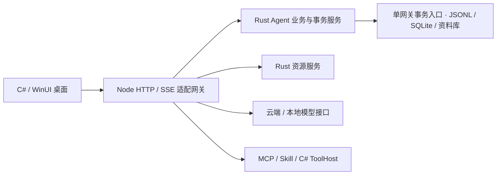

# Rust Agent 服务接线与迁移历史

当前生产入口正在切换为独立 Rust HTTP/SSE 网关，详见 [独立 Rust 网关](native-gateway.md)。下文保留 2026-10-11 及此前混合版实现和验证记录；其中 Node/NAPI 接线、旧启动命令和测试数属于历史阶段，不能作为新发布链路或本轮验收成绩。

更新：2026-10-11。迁移前基线 `c9e83ef` 已推送。本文描述已接入的原生业务、事务服务和必要 SDK 适配；历史验证按阶段保留，不能把旧结果当作本轮证据。

## 控制与计算模块

| Rust 模块 | 实际拥有的控制逻辑 | 保留的适配工作 |
|---|---|---|
| orchestration/task.rs | 模型尾部状态、重复正文指纹、续接/完成核对/停止决策 | 流式展示、提示组装、供应商请求 |
| orchestration/budget.rs | 请求额度校验、单调准入、上下文余量、Unicode/Han 计量、精确边界重放裁剪 | token 估算、实际计时、归档与取消 I/O |
| orchestration/budget.rs · allocation | 证据/schema 任务配额及请求/实际额度审计 | ECMAScript 数值投影、实际已组装消息的计量接线 |
| tools/effects.rs | 已完成操作保护、未知结果账本、broker 核验、恢复事件与计数 | 权限审批、真实执行、归档、新旧回执绑定 |
| tools/observations.rs | 来源/版本/范围重复检测、失败目标检测 | 来源原文与 broker 操作语义投影 |
| orchestration/progress.rs | 诊断聚合、验证命令识别、代码版本与实际执行回执账本 | 时钟、token 估算、持久化回调 |
| orchestration/context.rs | 输入输出额度、成功历史轮配对、重复和旧版本观察压缩计划 | 原始协议解码、路径规范化、原文哈希与提示模板 |
| retrieval/lexical.rs、window.rs、token_fit.rs | 分词、查询桥接、FTS 表达式、UTF-16 窗口与引用覆盖、token 拟合 | Markdown 解析器、原文切片、取消与索引 I/O |
| retrieval/query.rs、budget.rs、candidates.rs | 原话与线索解释、任务关系、检索额度、候选去重/选择 | 原始对象映射、真实时间与原文 JSON 计费 |
| retrieval/chunking.rs、code_units.rs、document.rs、relations.rs | 分块位置、代码单元筛选、章节层次与关系派生 | TreeSitter/WASM/Markdown 的实际解析；未解析关系仍标为候选 |
| retrieval/evidence.rs | 缺口、来源版本、回读状态、预算、无收益与失效账本 | 有界原文缓存、精确引文校验、来源读取与归档 |
| models/protocol.rs、stream.rs、plain.rs | 三协议普通/工具流状态、终止原因、调用解码与 token 估算 | HTTP/SSE 字节读取、增量事件发送、原始供应商对象与私有续接身份 |
| models/context.rs、history.rs、memory.rs、recovery.rs | 上下文裁剪、历史配对、记忆选择、模型错误恢复计划 | 原文切片、提示文字、正式日志与摘要 I/O |
| tools/discovery.rs、intent.rs、policy.rs | 工具发现、任务意图、禁止对象/窗口约束、审批规则 | 实际目录与 descriptor 身份、授权快照与真实派发 |
| tools/contracts.rs、configuration.rs、browser.rs | 输入/环境/配置合同、MCP/Skill 元数据、浏览器目标和回执规则 | YAML/MCP/Acorn/URL 解析、Windows 路径与实际会话 |
| storage/memory.rs、retrieval.rs、settings.rs、candidates.rs | 数据/设置/记忆合同、候选记忆规则与合批触发 | CAS 持久化、原文与既有 JSON/SHA 身份、文件队列 |
| resources/fallback.rs、coordination.rs、inference.rs | 兼容资源额度、隔离预约、准入队列/公平让路、分后端反馈、恢复退避、模型需求与批次估算 | 真实硬件采样、资源进程 IPC、定时器/回调、PID 与进程退出确认 |

`orchestration/agent-control.mjs` 是类型与生命周期适配，`platform/agent-core-client.mjs` 负责有界后台 IPC。生产 ModelRuntime 默认注入 Rust 核心，普通聊天也复用它。独立同步接口使用 `platform/agent-core-binding.mjs` 加载同源 Node-API 模块；旧 JS 控制规则已删除，同步测试与供应商适配不再拥有另一套计算实现。在同一活动请求里，Rust 故障不能切回空账本。

同步纯计算不逐次启动进程；原生辅助会话通过不透明 Rust 对象管理状态，关闭或 GC 时释放。历史配对和观察压缩只传简短元信息，返回索引再映射原对象；不复制整份聊天和供应商私有状态。来源窗口、token 拟合的坐标由 Rust 计算，正文始终回到原始 JavaScript UTF-16 字符串切片，保持原文、哈希和孤立代理字符不被传输投影改写。状态快照只保留摘要，完整诊断及回执按需查询。

任务每轮、模型返回后以及工具派发前检查额度。成功回执先持久化，再写入请求恢复账本；模型不提供“执行成功”的权威证明。完成核对不提供工具声明，核对文字不渲染为正文。模型可见检查点只包含 state/next/reason；诊断计数保存在正式执行记录中，避免模型把计数抄成非法尾部。

## 原生业务与事务服务

下列服务已由真实适配入口调用，Rust 拥有状态或事务，Node 不再保留同名业务实现：

| 领域 | 原生职责 | Node 保留的实际适配 |
|---|---|---|
| 存储 | 稳定句柄读取、CAS 原子提交、JSONL/torn-tail 恢复、目录/迁移事务、记忆持久化、资料快照、覆盖/检查点/经验库 | 单网关队列、原始 JSON/SHA 身份、日期与客户端合同 |
| SQLite | 有范围的 FTS/排序统计、来源/块/关系/向量空间事务、代次、回源核验、schema/backfill | sqlite-vec 插件的实际加载、TypedArray/Blob 编码与派生向量索引 SDK |
| 工具 | 目录、审批、配置层、文件 CRUD/搜索分页、Skill 包与环境、浏览器/终端作业、受保护位置、HTTP/MCP 契约与缓存 | ToolHost/浏览器/MCP 真正通信、Acorn/YAML/HTML 解析、权限回调和实际句柄 |
| 模型 | 推理生命周期、Worker 队列/重建/取消、后端与空间兼容、批量/资源准入/驻留、外部模型观测与预测协调 | ONNX/Transformers 会话/Tensor、真实 HTTP/Worker、进程与租约回执；不擅自关闭用户外部模型 |
| 编排/检索 | 工具循环恢复、证据发布、来源缓存与增量作业、索引/ANN 状态、挂载/记忆准备、候选工作区 | 真实 Promise/AbortSignal/监听器、来源原文句柄、实际索引/模型 SDK 调用 |

文件/SQLite 服务在线程池执行；同一请求的取消令牌跨原生事务保留。取消前未提交的事务回滚，实际已提交的写入保留提交回执，不因晚到取消盲目重放。同步启动工厂仍保留原公开合同，少量配置指针读取可在同步原生调用中完成；大正文、日志和普通事务使用异步执行器。

传输上限统一维护在 `transport.rs`，Node 先读取同一张额度表再编码，Rust 解码与回传也按它检查。清单、日志和资料的扩展帧只兼容既有源限额，不增加模型输入、来源权限或可见正文。派生 ANN/向量缓存与正式数据库区分：缓存失效按代次和空间重建，不能成为独立正式写入者。

## 生命周期与故障

- 网关拥有一个隐藏原生进程，每个请求创建独立会话；结束、取消或失败后关闭会话。进程 stdin 关闭后退出。
- IPC 帧限制 8 MiB，客户端最多 128 个待回执请求，核心最多 64 个活动会话；不保存模型凭据，外部执行仍须经过现有授权入口，不扩大工具权限。
- Node-API 普通有状态调用限制 8 MiB、纯计算限制 32 MiB；模型流和完整回复投影使用 64 MiB JSON 传输额度，以保持工具流 2 Mi、普通流 8 Mi UTF-16 的原有正文上限。它不扩大正文、模型上下文、工具参数或副作用账本的合同。
- 流状态与证据账本使用独立不透明会话；每帧只返回新事件，结束时返回一次完整结果。UTF-16 长度按增量累计，避免长输出每帧重扫累计正文。原生装载在文档热解析截止时间开始前完成。
- 原生进程仅继承必需 Windows 环境字段。IPC 的正文投影修复孤立 UTF-16 代理字符，并计入诊断；原文归档保持原样。工具身份和参数出现无效 Unicode 则拒绝，不能因替换字符把不同动作合并。
- 活动状态丢失或 IPC 超时使后续派发失败，既有正文、源日志和执行回执保留。所有失效会话关闭后，下一独立任务才可重新启动核心。
- 原有入口路径和桌面启动协议保持不变。开发源码入口通过准备脚本校验/构建缓存；随包直接使用原生文件。构建缺失返回明确错误，不能把 Node 降级报成 Rust 已启用。
- `/health` 返回实际 agentCore 引擎、就绪状态和能力；核心不可用时返回 503，不归为模型 JSON 或存储解析错误。
- EXE 与 `.node` 位于内容哈希版本目录，`runtime.json` 原子发布路径。开发构建使用跨进程锁并在取得锁后复核缓存；不就地覆盖已加载文件。合法性参数错误保留 HTTP 400，运行时加载/状态失败保留独立错误类别。

## 边界和规范

A 维护核心组合、orchestration/resources、传输集成与打包；C 维护核心 models 及 Node 模型适配；D 维护核心 tools；E 维护核心 retrieval/storage 并继续拥有正式数据模块；B 界面文件未迁移。模块主责来自 module-ownership.json，架构校验覆盖 Rust 模块目标、跨域引用和依赖白名单。纯状态域不执行 I/O；真正的文件/SQLite 执行模块逐个列在机器主责清单的 executionModules 中，其他模块不能借迁移任意加入文件、网络或进程操作。

Node 保留 HTTP/SSE、MCP SDK、供应商原始身份、ONNX/Transformers/TreeSitter/文档解析器及 usearch/sqlite-vec SDK 的真实调用、原始 JSON/UTF-16/ICU 身份，以及 Promise/Worker/AbortSignal 与权限回调接线。正式日志、普通 SQLite 检索/事务、资料和受控文件 I/O 已改调原生服务。规则迁移时返回索引或范围，再映射原始对象，避免大量正文复制；不为增加删除行数改写哈希、签名或日志编码。Acorn 解析返回 AST，安全遍历与别名判断由 Rust 负责；文档 SDK 解码留在受限 worker，来源检查、预算、分页和生命周期由 Rust 负责。JS 仍含实际 SDK 与异步接线，不能宣称仅有几行转发。迁移以实际调用和单一状态所有者验收，不将 SDK 对象映射误算为第二份业务状态。新增可独立的计算与状态逻辑优先放 Rust，JS 需说明具体适配依赖。Node-API 桥接采用 [napi-rs 官方接口](https://napi.rs/docs/introduction/getting-started)，只借用绑定机制，不复制其他 Agent 的内部实现。

Rust 使用 snake_case/UpperCamelCase、Result、rustfmt 与双语说明；公开 JSON、错误码、工具名、源版本、作用域和启动命令保持兼容。两种原生服务复用构建、源码指纹、许可证和缓存校验，不重复维护打包实现。

本轮以原生控制单测、真实 IPC、旧控制规则配对、工具循环与 HTTP/SSE 定向回归、桌面构建验证迁移。不重新下载用户模型、不重复全量基准、不重启正在工作的旧网关。

## 首轮接线验证

- `cargo test --manifest-path apps/agent-core/Cargo.toml --locked --offline`：18 项通过。
- Node 定向回归合计 183 个不同用例通过：任务/输出/上下文 78、执行额度/计时/观察缓存/存储迁移/资源桥接 42、步骤恢复 27、原生 IPC 12（11 项真实 EXE、1 项受控传输）、推理生命周期 16、存储维护 8。该数包括旧同步接口和默认 Rust 的 HTTP/SSE 请求，不等于全仓测试或模型基准。
- 实际 Rust EXE 与现有 JS 控制规则配对：任务状态 62 个、回执与读取保护 23 个检查通过；另有 5 个 Rust 架构边界检查通过。这些属于配对诊断，不加进上面的 Node 用例数。
- `GatewayStartupSmoke`、`ChatStreamSmoke` 通过；桌面 Debug x64 构建通过，0 警告、0 错误。51 个原生包文件哈希一致，随包 EXE 与源码构建一致，体积 1,790,976 字节。
- 架构检查：380 个自有生产源码文件，8 个 Rust 核心文件，0 违规。
- 使用最新随包 Node 入口与独立临时数据读取实际 HTTP `/health`：200，agentCore.engine=rust、state=ready、activeSessions=0；所有测试拥有的进程和临时数据均已关闭/清理。

修复了检查中实际发现的两个退出边界：其他运行时清理失败后仍关闭自有 Agent 子进程；嵌入/重排路由关闭后查询状态只读现有事实，不新建会话，不把清理失败报成已卸载。

原有真实 E5 存储维护测试盯住 CPU 实例，而自动策略实际选了另一个 GPU 空间。先固定该 CPU 夹具的设备策略，再验证后台推理期间的迁移、回滚、worker/WAL 排空，两种路径通过。独立诊断还观察到自动 GPU 作业完成 101/101 块；不据此宣称完成 RAG 全量质量、吞吐或规模验收。

以上均使用独立临时存储、模拟模型上游或随包 E5，不调用用户云端 API。未进行新 UI 操作验收、真实 Qwen/DeepSeek 长任务对照或全量性能基准。

## 删除旧规则后的增量验证

本节是继续迁移后的实际检查；前述 183 项为首轮记录，不再与本节相加。既有大规模质量与容量基准未重跑。

- Rust `cargo test --locked --offline`：30 项通过（29 个库用例、1 个有界帧用例）。
- Node 定向合计 353 个不同用例通过，1 个既有真实 E5 opt-in 用例未启用：控制/恢复/同步绑定 112，上下文 42，进度与诊断 15，词法/窗口/token/SQLite/文档结构 72，HTTP 运行时与工具循环 112。失败修复后的重复运行不再次计数。
- 与迁移前纯规则配对的 8,500 项断言一致：词法/查询 4,944、UTF-16 窗口与章节 3,341、token 拟合 215。这些是等价诊断，不是 8,500 个 Agent 任务。
- 同步绑定实测：两辅助会话隔离、关闭后拒绝调用、500 个对象 GC；2 Mi UTF-16 控制字符经约 12 MiB JSON 转义仍能返回正确窗口，32 MiB 纯计算与 8 MiB 会话超限分别拒绝。
- 两进程并发准备复用同一哈希缓存，无重复编译或覆盖已加载 `.node`；实际原生版本哈希为 `28159ff00297a3ec017ae172f768c225ef734278755d71d3a41815a59fef8de9`。
- `GatewayStartupSmoke` 通过；桌面 Debug x64 构建 0 警告、0 错误。95 个随包文件哈希与准备缓存一致；使用最新桌面输出目录中的网关和独立临时数据读取 `/health`：200、Rust、ready、activeSessions=0，所有本轮自有进程关闭。
- 架构检查覆盖 388 个生产文件、180 个网关模块、15 个 Rust 核心文件，0 违规。CODEOWNERS 依据同一职责清单重新生成，沿用已有账号，不更改远端权限。

本轮也修复了旧测试夹具与当前合同不一致的问题：空正文 `/props` 探针不再被当作生成 JSON；历史断言区分正式消息与运行时 system 指导；工具声明按 wireName 识别；摘要与回答分别计数；导入撤销夹具避开独立自动挂载来源。基线已核查相关产品机制存在，未为测试修改模型、挂载或权限行为。

## 模型、工具、检索与数据规则迁移收口

本阶段继续删除旧 JS 规则，实现上表新增领域。迁移前 Github HEAD 为 `c9e83ef`；没有重置已有未提交改动，也没有修改 B 展示源码。新增独立规则优先使用 Rust，启动入口、正式存储格式、工具身份与权限合同保持。

同一自有后端统计范围（排除前端、测试、依赖及生成产物）：生产 JS 从 HEAD 的 33,042 行降至 29,936 行，净减 3,106 行；相对本阶段开始的 32,994 行净减 3,058 行。Agent 核心为 45 个 Rust 文件，移除内嵌测试后 14,364 行。上述为含空行与说明的物理源码行数，不代表新增功能数或全部可执行语句；纯计算迁移后的类型、错误与适配使总行数增长，不能以语言比例宣称功能提升。

实际验证分开记录，以下领域有交叉文件，不将各行测试数累加成总任务成功数：

| 范围 | 本阶段实际结果 |
|---|---|
| Rust 核心 | 32 个库用例及 1 个帧边界用例通过 |
| 真实原生控制与 IPC | 17 个用例通过，含未知副作用、崩溃、关闭、配置类型与 PDF 必需字段 |
| 工具领域 | 14 文件 179 唯一用例；176 首次通过，3 个 8K 实际目录问题修复后通过；15,123 旧新差分一致 |
| 证据/schema 额度适配 | 原有 4 个用例通过；1,752 个旧新 JSON 对照一致，审计未知字段保留 |
| 检索领域 | 14 文件 189 唯一用例：188 通过、1 既有 E5 opt-in 跳过；1,942 旧新差分一致 |
| 存储合同独立审查 | 196 旧新探针一致，含原文/哈希/作用域、非有限数、undefined、伪造 marker 与输入不可变 |
| 模型受影响链路 | 34 个最后定向用例通过；快照修复后单独复测 streaming 19/19；6 个公共大正文边界通过 |
| 模型纯规则对照 | 1,112,064 个 Unicode 标量、3 个完整上下文投影、114 个摘要额度、200 个历史计量均一致 |
| 数据与资源集成 | 12 文件 189 用例中 187 首次通过；记忆摘要夹具预算及资源压力下两项后续在独立记忆集成中通过 |
| 客户端与启动 | GatewayStartupSmoke、ChatStreamSmoke 通过 |
| Windows x64 桌面 | Debug 构建通过，0 警告、0 错误；最新原生组件随包 |
| 最终随包启动 | 100 个原生包、声明与清单文件哈希一致；随包 Node 的真实 `/health` 为 200、Rust、ready、activeSessions=0 |
| 最终架构检查 | 418 个生产源码、180 个网关模块、45 个 Rust 文件、7 个直接依赖，0 违规；git diff 空白检查通过 |

最终随包原生源码指纹为 `52e440ea1e16869b21d594794d1e3c23a7509874322e8f5b5ced5139be33cf23`。启动检查使用独立临时数据，已关闭本轮拥有的服务及原生进程，并在核对绝对路径后清理临时目录；未触碰日常网关与聊天数据。

本轮修复实际发现的迁移边界：文档冷装载误计入热解析 deadline；稀疏数组/非有限数/undefined 在 JSON 边界的语义；PDF `nextPage` 缺失与明确 null 的区别；低 token ceiling 的原有 Math 兼容；证据缓存更替；长流累计计数与最终正文重复传输。成功写入不因这些恢复重放。

也修复了现有上下游接线：schema 额度按真实系统提示、当前问题和历史通知计量，不重复扣已有硬输出/安全预留；预算审计保留请求上限、实际可用额度与使用量。主模型硬窗口、来源/模型版本、权限、取消与副作用保护仍由程序执行。

部分旧夹具未跟上产品：模拟 HTTP 端点需正确拒绝 `/props` 观察并单独计数，文本协议应按真实内容块取原文，SSE 夹具用确定性资源服务，长度终止与工具预算要验收已有有界续接/恢复。保留日志、内容、作用域、预算和一次副作用断言，没有修改产品来满足旧的直接中断预期。源码变化期间的准备失败与旧夹具失败均已定位，不冒充本轮产品成功。

这些是工程迁移与兼容验证，不是新的检索质量、百万容量或模型 Agent 基准；未重新下载模型，未运行用户付费 API，未重启用户正在使用的网关，也未宣称新 UI 操作已验收。

## 完整业务迁移与运行时边界

本节记录最终业务迁移，前面的数字保留为各阶段历史记录，不作为最终版本的验证。

- Rust 拥有旧数据迁移的扫描、流式复制及 SHA 核验、精确备份、指针激活条件、工作区归属；Node 只保留原始 JSON 编码和正式存储初始化回调。
- 来源索引、符号/路径搜索、向量描述与分片读取均使用原生 SQLite；Node 的内存 SQLite 仅承接 sqlite-vec 插件的真实向量距离调用，不另开正式数据连接。
- 资源监控失联后仍保留原生隔离预约；队列顺序、前台准入保护、反馈历史与恢复退避由单一原生账本决定。Node 仅持有实际进程、Promise、AbortSignal 和定时器回调；监控恢复先重建真实预约及执行器身份，确认后才切回原生准入。
- 消息段顺序、状态、耗时由原生账本管理；原始 UTF-16 正文缓冲和事件回调保留在 Node，结束时释放辅助会话。
- 文件与来源服务核对真实目标、稳定句柄、硬链接、范围和 SHA；公开 Node Number 元信息不替代原生精确文件身份。
- 受限文档 worker 的原生模块只开放明确列出的纯文档控制操作；普通存储、来源 I/O、工具执行及共享取消令牌不可调用。限制在模块装载时绑定到 Node 环境，修改 JS permission 属性不能扩大能力。环境退出后回收登记。
- 模型服务以真实 SDK、进程和租约回执结算资源；Promise 完成但没有释放状态不算已释放。

最终统计使用同一自有生产后端范围：排除前端、测试、依赖和生成产物。相对 GitHub/本地 HEAD `c9e83efb8b90168161b73294d739cb1bb198aa7f`，网关 JS 从 33,042 行降至 22,140 行，净减 10,902 行（约 33%）。Agent 核心为 160 个 Rust 文件，生产部分 55,925 行；移除内嵌及独立测试块后统计，包含空行、声明和双语说明，不代表新增功能数或可执行语句数。原始阶段快照的 32,994 行不再用于 GitHub 差值。

最终原生产物源码指纹为 `adc6f16578f955a1f21487787c87c6246005e63bbaa8596548db457e730348c3`。真实业务由 Node-API 同源模块执行；EXE、模块和依赖许可证使用同一版本化清单，开发及随包启动路径一致。以下验证按范围记录，不把重复复测相加为任务数：

| 范围 | 实际结果 |
|---|---|
| Rust 核心 | 79 个库用例及 1 个有界帧用例全部通过；0 编译警告 |
| 模型与来源 44 文件 | 477 通过、3 个既有真实模型 opt-in 未启用；最后改动的上下文与模型历史另外复测通过 |
| 工具 33 文件及官方工具 | 377 通过、0 失败、0 跳过；含真实 ToolHost 能力通道、旧 Skill 禁用标识与 MCP 恢复 |
| 数据 19 文件 | 214 全部通过；含正式 SQLite、真实向量 SDK/ANN、日志恢复、来源元数据和大正文 |
| 运行时 78 文件 | 广覆盖发现的 7 项失败均已定位并复测通过；2 个既有容量/真实模型 opt-in 未启用 |
| 最后运行时/上下文 9 文件 | 108 个不同用例最终通过；其中结构集成夹具修正后整文件 8/8 复测通过，不重复计数 |
| 资源及统一检索 | unified-policy 完整 8/8；真实两个后台图独立所有者、确认退出后预约归零 |
| 读取恢复 | 13/13；关闭元信息、重复关闭和 ANN 正零额外检查通过 |
| 来源新鲜度 | 80 次真实新文件元数据/描述/读取通过，保留精确时间戳与 SHA 校验 |
| Windows x64 桌面 | Debug 构建 0 警告、0 错误；B 展示源码无差异 |
| 随包启动 | 188 个原生载荷文件哈希与清单一致；随包 Node 的真实 HTTP /health 返回 200、Rust、ready、activeSessions=0 |
| 静态检查 | 548 个生产源码、195 个网关模块、160 个 Rust 文件、12 个直接依赖，0 架构违规；198 个生产 ESM 语法检查及差异空白检查通过 |

本轮修复了实际发现的迁移边界：MCP/结构/传输/ANN 的最后派生策略收回原生状态；来源时间戳采用精确浮点往返，实际变化仍拒绝；旧 Skill 路径标识按 Windows 组件归一；正式日志头部校验只传元信息，传输/装载故障不得授权日志尾部恢复；资源释放必须有实际回执，索引初始化先登记监听再异步打开数据库；派生图清理失败不改写已提交事务的成功事实。

大消息用例实际写入 8 Mi UTF-16 控制字符（JSON 约 48 MiB），验证无末尾换行的合法记录可重开；注入原生传输故障后，文件 SHA 不变、不产生恢复备份，恢复正常解码后正文完整。上下文投影仅把明确预算输入码转为 ContextError；加载、状态与帧故障保留原始分类，不能误作 HTTP 400 后缩减工具。

部分原夹具存在独立来源及所有者生命周期假设：挂载与导入的同一文件是两个有效来源，导入撤销用例改为只拥有外部导入文件；重启夹具为已经关闭的沙箱创建新 SDK 所有者。没有因此修改产品排序、扩大权限、复用关闭实例或重放历史操作。真实执行环境的变更使最终两项 ToolHost 能力检查可执行并通过，前两轮的跳过记录仍保留。

完整日志保留在 `artifacts/development/migration-verification/`、`artifacts/development/tool-migration-golden/` 与 `artifacts/verification/`，均不进入正式聊天或提交载荷。测试使用独立临时数据和模拟模型上游，未调用用户付费 API、未重启日常网关。这里是语言迁移和兼容验收，不是新的 RAG 质量、吞吐、百万容量或 Qwen/DeepSeek Agent 基准。

## 2026-10-11 项目目录冷启动修复

实机项目与发送控件均未就绪；目录接口仍能返回正确数据，但 85 个聊天的追加日志累计约 1.18 GB（14,797 次事件），热态目录读取约 11.65 秒。桌面目录客户端原有 30 秒截止时间，为首轮完整校验和繁忙机器留下的余量不足。HTTP 健康检查成功不能代替目录可用性验证。

正式日志读取仍核对稳定文件身份与完整 SHA。已缓存的相同来源不再跨 Node-API 传输全部历史；原生事件排序借用正文，只解码身份与角色，并保留旧 UTF-16 兼容、取消、版本冲突和损坏尾部规则。消息类型已由统一原生合同校验，网关恢复原始 UTF-16 时不重复逐字段跨桥。E 的目录 API 客户端保留有界的两分钟等待及调用方取消；B 的界面源码未修改。

本次专项验证：21 个原生存储用例、36 个会话/HTTP 续接/分段/计时用例全部通过。合成 85 个聊天、14,797 次更新、686 条当前消息约 167 MiB 日志，首次约 3.2 秒、独立进程重开约 4.4 秒。真实数据仅复制到独立临时快照核查，1.18 GB 日志首次约 23.9 秒、热态约 2.1 秒；11 个项目、85 个聊天、686 条消息一致，38 份非空日志哈希保持不变，不产生尾部恢复文件，私有临时快照已删除。未调用真实模型或付费接口。该结果是本机单次诊断，不能当作任意规模/P95 承诺。

当前原生源码指纹为 `6d181e421213af68ab03f782bbdef8b82b8baa2ddc87107c5d828af7bc5a4ed4`。本次证据保存在 `artifacts/development/catalog-recovery/`，报告只包含计时、数量、完整性结果，不含真实聊天正文。

桌面 Debug x64 本次构建 0 警告、0 错误。通过既有 `dotnet run --project apps/desktop/KYNXA.Desktop.csproj -p:Platform=x64` 流程刷新调试包并启动后，实际项目树显示 10 个当前可见条目，添加项目和工作区选择恢复启用；临时输入检查确认发送按钮可启用，随后还原原草稿，没有提交测试消息。实际目录 HTTP 200、11 个项目/85 个聊天，热态约 1.6 秒。调试 AppX 目录需要经过 Run 的部署步骤刷新，不能直接启动残留的旧暂存副本。

## 2026-10-11 混合目录发送修复

上一次控件启用检查没有验证完整发送链路。后续实际点击发送，复现 `Cannot read properties of undefined (reading 'map')`：桌面工作模式只提交 `Projects`，聊天模式只提交 `Chats`；正式目录中另一作用域保留的是不带 `Messages` 的元信息。网关生成保存计划时错误地假定两侧都携带正文，在派发模型请求之前抛错。实机同时包含 11 个项目与 26 个独立聊天，故该缺陷影响正常发送；不是模型拒绝、资源不足或缺少工作目录。

局部目录提交现在把未提供的 `Messages` 视为没有新提交的正文，既有历史仍从正式事件日志核对，不删除、不覆盖。事务完成只撤销正式写入或移动所涉及的日志缓存，未变化的缓存继续核对完整文件 SHA；崩溃恢复仍重建缓存。由此避免每次元信息保存都重新解析全部追加历史。公开目录合同、作用域、版本冲突与原始消息 ID 保持不变，B 界面源码未修改。

本轮会话存储整文件 20/20、会话 HTTP 运行时整文件 7/7 通过。新增混合目录回归分别覆盖仅 `Projects`、仅 `Chats` 的桌面形态，检查新用户消息、两侧原历史、归属、版本递增与重开；HTTP 用例进一步确认两次模拟模型真实派发及正式 `completed` 回复。测试使用独立数据与模拟上游，不把历史测试数量计入本轮成绩。

使用用户已授权的既有 DeepSeek 连接，隔离发送测试约 2.1 秒完成。修复同步至实际随包网关后，仅停止已核验空闲的旧网关，保留桌面和草稿；下一次界面保存沿既有 `ModelGatewayService` 链路自动启动新版。实际界面发送“你好”完成，助手消息关联到本次用户 ID，状态为 `completed`、无错误，发送控件恢复，原四字符草稿还原。首次包含网关重启及 1.18 GB 历史校验，观察约 43.4 秒，不能把隔离模型的 2.1 秒当作该实机冷启动耗时。证据位于 `artifacts/development/catalog-contract-diagnosis/` 与 `artifacts/development/catalog-recovery/`，仅记录脱敏状态与计数。

## 2026-10-11 即时提交展示

依据用户后续对即时发送的明确要求，调整 `ShellPage.Chats` 与 `ShellPage.StreamReplies` 的接线。发送按钮同步建立用户消息、清空本次输入、建立可停止的等待回复占位并更新对话；之后在回复生命周期中异步保存，再请求模型。保存与网关启动不再阻塞第一份展示，顶部生成计时仍从首个实际模型消息段开始，不把排队等候冒充生成用时。

保存前后均核对聊天对象、工作归属、本次用户 ID/角色/正文、当前运行占位及取消状态。保存失败在本轮显示错误并正常收尾，不通过通用项目回滚删除本次输入，不派发模型；重试保留原用户/请求 ID，先重新提交对应工作或独立聊天范围。保存期间停止不撤销已提交的用户消息，但阻止后续模型派发；等待中编辑的新草稿不被晚到回调清空。展示时间缓存异常也通过 `finally` 释放取消资源、停止空闲计时器并恢复发送控件。

最终源码审查确认这些路径；Windows x64 桌面最终构建 0 警告、0 错误。既有 `ConversationStoreSmoke` 和 `ChatStreamSmoke` 全部通过，分别覆盖首个 await 前的保存快照、新用户过滤、版本冲突，以及增量 SSE、取消、恢复与错误。会话存储夹具的模拟健康响应原先漏了现有必需的 `retrievalProtocol: 1`，仅补合同字段后重跑通过，全部业务断言保留；该夹具问题不是产品发送缺陷。

在没有活动回复时正常关闭桌面，由既有 Run 部署流程刷新并启动新版，保留正在运行的网关；已验证实际 AppX 程序集与最终构建哈希相同。此后用户正在新版发送消息，首帧测量脚本因此没有派发额外测试，也没有关闭或中止当前回复。前面的真实模型完成回执验证的是网关发送修复，不将它或独立组件短测当作新版本实际点击的首帧时序验收。记录保留在 `artifacts/development/catalog-recovery/instant-send-*`。

## 2026-10-11 重复与无调用 JavaScript 清理

本轮只清理能够确认的死代码与重复适配实现，保留已有迁移和发送修复。删除前核对生产调用、测试、文档、动态入口和注册关系；不因函数没有直接调用就删除 SDK 回调、命令入口、worker 入口或仍有消费者的兼容接口。

- 数据、工具、模型和编排层删除无调用的旧包装及别名、旧常量、未使用导入；重复导入合并。权限、来源版本、正式存储和原生工具调用限制仍由实际执行链路负责。
- IPC 与 Node-API 共用一份 Unicode 身份校验；嵌入与重排进程共用一份真实 PID/RSS 采样。共用实现放在已有模块，没有新增生产文件，原错误、深度边界、采样时机和字段保持一致。
- 模型历史中，同一调用参数只编码一次，同一归档回执只执行一次 broker 编码与原生计算，再复用结果填充两个历史字段。保留原文、公开投影、字段顺序及正式回执。
- 仍有调用的 ModelHistory Set/Proxy、SDK/异步接口和资源策略不能作为死代码直接移除。旧兼容测试入口保留，不将测试入口当作当前生产路径，也不将本轮清理宣称为所有策略已完成原生统一。

采用相同自有生产网关范围，排除前端、测试、依赖和生成产物：本轮开始为 198 文件、22,157 物理行、19,430 非空非注释行；清理后为 198 文件、22,052 物理行、19,344 非空非注释行。净减少 105 物理行、86 非空非注释行。非空非注释统计仍包含 schema、提示文字和声明，不等同于有效功能数量。相对 HEAD 的迁移累计差值不能算作本轮删除量。

本轮定向验证使用独立临时数据、模拟模型上游及已有真实原生模块；没有下载模型、重跑全量基准、重启日常网关或操作用户软件。

| 范围 | 本轮实际结果 |
|---|---|
| 数据与引用合同 | 6 个文件，86 通过 |
| 编排与检索集成 | 2 个文件，26 通过；另一个路由文件的 20 个用例已计入数据范围 |
| MCP、浏览器、Skill、发现和桌面适配 | 142 通过 |
| 模型历史、工具恢复、观察与路径 | 97 通过；最后历史编码修改另复测 29 通过，不重复累计 |
| 原生接口与进程恢复 | 19 通过 |
| 推理进程和资源采样 | 39 通过、1 个真实双模型资产用例未启用；真实原生 CPU/DML 字段采样检查通过，不代表实际 GPU 模型推理已验收 |
| 最终静态检查 | 198 个生产模块解析通过，913 个命名导入无缺失；已扫描函数声明无完全相同的结构化函数体；架构检查 0 违规 |

以上共 409 个不同用例通过、1 个可选用例跳过，不把重复复测及独立采样断言加成任务成功数。证据保留在 `artifacts/development/js-cleanup/` 及 `artifacts/development/catalog-recovery/tools-unused-js-cleanup-*`。这是删除与兼容验证，不是新的 RAG 质量或 Agent 任务评分。本轮未修改界面、提交或推送，也未中断正在运行的任务。

## 2026-10-11 适配成本与剩余策略收口

本阶段保留 Node 的实际 SDK、原始对象及异步接线，在已有模块中消除重复工作，不新增生产文件或替换第三方库。

- 技能冷读共用一次受限 YAML 解析和一次原生 `tools.validateSkillHeader`，同时取得可读头部和标准诊断；独立 parse/validate 入口、旧技能兼容、源字段顺序及不安全 YAML 拒绝保持。原加载路径需要两次解析、两次原生计算，现各一次；命中现有缓存的行为不变。
- 既有 Rust 检索预算统一接收本地重排配置与实际资源建议，返回完整授额和审计；Node 不再计算第二份重排规则。本地配置优先、20/40/60 档位、资源上限、原截断原因及零上下文额度早退保持。
- `models.recovery` 决定被拒模型步骤是否允许重试、递增次数、缓存合并、失效和最近写入淘汰。Node Map 保留原始连接/模型键并执行变更计划；两次恢复、10 分钟缓存、32 条容量保持，读取不续期，独立输入/输出限制继续合并。被拒请求的资源先释放，再压缩重组；成功操作和结果未知的副作用不重放。
- MCP 结果分类与文本预览共用同一次原生输入；附件补读仍独立异步校验和读取，只返回追加媒体说明。正常返回路径的完整结果输入由 outcome/archive/preview 三次降为 outcome/archive 两次；标准块、结构化字段顺序、私有元信息及正式 canonical 原文保留。失败路径继续使用原独立预览，取消附件补读不丢上游已完成回执。
- MCP 诊断 size/has 直接返回原生数量/存在性，不再读取完整记录；delete 单次返回是否删除，SDK 对象身份、诊断代次、修订及晚到回执保护保持。检索候选每行的 locator 也只解码一次，行号和 UTF-16 偏移不变。

本轮真实原生包已准备，源码指纹为 `7ccd6e0328f1d1abd45fb29feb4e253849029d76ad5faa71bc18b3d962c8c614`。15 个相关网关文件共 236 用例全部通过，0 失败/跳过；5 个 Rust 预算/恢复用例通过。覆盖三协议恢复、资源释放与缓存失效、技能诊断、MCP 连接/媒体/长结果、截图补读与取消、正式原文归档。测试使用独立数据、模拟模型和合成媒体；没有调用用户真实模型、付费 API 或启动浏览器界面。

198 个生产 ESM 解析和 913 个命名导入检查通过，架构检查 0 违规。生产 JS 为 22,063 物理行、19,343 非空非注释行；相对本阶段开始物理行增加 11，非空非注释行减少 1。新增双语说明与适配入口使行数不能代表运行开销；这里确认减少了重复处理，不承诺未经测量的端到端提速比例。未新增依赖，B 界面和正在运行的网关未修改或重启。

构建、测试和静态证据保存在 `artifacts/development/js-cleanup/adapter-*`。本阶段没有完整基准、真实 GPU/模型任务或新界面验收，也没有提交或推送。

## 2026-10-12 检索与发布边界收拢

`storage/sqlite_connections.rs` 按数据库持有有界连接池：最多 8 个独占读取租约及 1 个写入租约，最多保留 16 个数据库池。池锁仅保护取还句柄，不覆盖 SQL 或活动读取快照；连接复用预编译语句、词法临时表与函数。请求分别绑定取消和截止状态，归还时清理事务、词法查询状态及回调。每次借用核对正式路径、侧文件及文件身份，替换数据库退休旧池，缓存按文件身份和索引版本失效。不同数据库的写入互不等待同一个全局写锁。

精确向量查询现在由 Rust 管理的 SQLite 连接加载随包 sqlite-vec，在一致读取快照内完成作用域、来源版本、模型空间过滤、距离及 Top-K；非有限距离必须在排序前排除。Node 只提供 SDK 的受信扩展路径，不再初始化第二个 SQLite 引擎中的相同扩展 DLL。精确查询不把整批向量转成 base64 传回 Node；候选回执只含标识、距离及必要元数据，ANN 建图的专用向量读取保留。批量候选复核共享范围版本与 SQL 语句，SDK 查询前后的新鲜度核对继续保留。

发布采用 `storage.retrieval.derivedChunks` 与 `storage.retrieval.lexicalBatch` 批量校验/派生，再由原生事务写入整批来源。Node 保留原始 JSON 字段顺序、UTF-16、SDK 向量编码和取消回调，不能把经 Unicode 标量修复的值重新作为正式历史哈希。已有源版本、派生签名、空间兼容、有限队列与容量保护不降低。源码扫描在 Rust 内稳定排序，并把 PDF/DOCX 路径延后到可处理文本之后；候选队列有界，超限报告覆盖缺口。文档最终完成仍须等待真正的解析资源准入。

本轮只采用独立数据、固定向量和相关短测；计量与前后源码快照位于 `artifacts/development/retrieval-boundary-20261012/`。这些结果不是实际 E5 推理速度、百万规模性能或完整 Agent 基准；长期缓存也不代表所有索引永久驻留。聊天历史分页及桌面增量展示见 [聊天与工作记忆](chat-work-memory.md)。修改保存在本机，暂不提交。

本轮最终增量检查：153 个唯一 Node 用例通过，1 个真实 E5 可选项跳过；4 个 Rust 连接池用例、43 个实际隔离 WebView 用例及桌面分页/保存客户端检查通过，最终 Debug x64 构建 0 警告/错误，架构检查通过。测试定位并修正非有限距离占据 Top-K、类型化查询向量 JSON 编码、分页可选参数编码，以及结构回读导入遗漏。最终原生源码指纹 `98afa06f6a47cad25fe6f7aabe631973a79bb9eb8084a74359f7f9e8c10e76be`。

Windows 同机 24 文件/168 块/384 维固定向量短测，词法、精确向量及 ANN 两次热查询均值分别为 31.27→17.53、76.62→46.25、161.02→131.54 ms；发布原生入口调用 870→149。Node 含 Worker RSS 采样峰值 85.70→93.93 MiB，关闭连接更慢，不能声称全面降低内存/所有阶段都提速。召回、范围隔离、更新、旧引用拒绝、ANN 重开复用均通过；单个 before/after 及两次热查询不支持统计外推。

新版隔离网关端口 5220 完成真实 DeepSeek Flash SSE 消息及正式历史检查，首事件约 27 ms、完成及回读约 3.33 秒。原端口 5218 的旧网关没有替换：自动审核拒绝了停止旧进程的操作，理由为 `blocked by policy`。测试没有让两个网关共写正式聊天或索引，也没有复制凭据到报告。实际默认软件仍需切换运行实例才能使用本次已编译的全部界面改动。完整状态见诊断目录中的 `completion-results.json`。

随后用户明确要求关闭旧实例并启动新版：再次核对旧网关无活动请求、Agent 会话及索引作业后，定点关闭旧网关；旧 Agent/资源子进程退出，隔离测试网关也已关闭。新版正式网关运行于默认端口 5218、进程 10820，沿用 `D:\KYNXA\Data\Models` 的已有配置；原生执行文件路径确认属于上述最终源码指纹。按既有 `dotnet run --no-build -p:Platform=x64` 流程刷新 AppX 并打开软件，进程 10968；运行目录中的桌面 DLL 与最新构建 SHA256 一致。健康接口为 ready，正式元数据读取成功。本次没有提交或推送。

## 2026-10-12 查询调用边界与展示收口

本阶段保留 Rust 业务与正式存储，不以语言迁移数量衡量优化。调用边界改为 `queryBegin`、可选 `queryVectors`、`queryFinish`：Rust 在一致快照内完成范围、代次、召回与候选复核，中间正文留在原生侧，完成融合后只读取最终入选正文。Node 保留 ICU 标识排序及 usearch SDK 真实调用。词法及显式精确查询通常采用两次数据库阶段，ANN 或自动向量路径通常采用三次；SDK 前后核对同一范围代次与数据库身份，不跨异步 SDK 持有事务。待完成查询有容量、期限及请求身份约束，失败与取消会丢弃该阶段状态，来源变化采用有界重新查询。

连接、临时词法表、连接级函数及预编译语句继续复用；候选批量复核共享一次读取边界。身份与侧文件安全检查在数据库阶段执行，减少同一阶段重复借用，不取消文件替换、链接和代次校验。`queryAudit` 记录实际数据库操作、句柄身份检查和路径检查数；这些是逻辑检查计量，不等于所有系统调用，更不能直接与外部 `strace` 数字对等。SDK 向量分页使用专用异步 NAPI Buffer；一次最多 256 行，元信息只带偏移、维度和身份，已存浮点位模式不再经 JSON/base64 编码。范围、代次、数据库身份和取消在原生读事务中复核；普通原始 UTF-16、模型 opaque 内容及正式哈希合同保持。

Worker 正式变更按顺序提交，有界读取可以独立推进；ANN SDK 的共享状态仍按单独生命周期队列使用，防止并发改图。正式来源发布后再处理可重建 ANN 派生更新；发布及删除在同一事务返回提交前后范围快照。派生向量只按提交后快照读取，更新前后由 Rust 核验图代次等于本次增量基线、数据库代次等于本次提交结果，以及拥有者/entryId 未变；计数、代次和 dirty 状态一次提交。版本不匹配撤销旧图，不能用后来读取到的最新代次给旧图贴新版本。状态与关闭等待相关作业完成，不能把发布回执返回或尚未完成的缓存更新计为全部 ANN 工作结束。父线程记录所有活动请求，只有已确认无副作用、无 ANN 作业的读取才能退休 worker，不用单个“最近操作”覆盖正在执行的写入。

ANN 业务账本仍只有一份原生状态；准备、派发和运行快照按批操作，Node 持有实际 SDK 对象与最近回执投影。状态突变更新对应投影，退休、淘汰和代次失效释放旧投影，不另建 Node 预算或业务账本。发布继续批处理；保留已有向量时由 Rust 直接写 BLOB，移除内部 BLOB/base64 往返及不再需要的空内存 SQLite facade。

二进制页的数据库身份通过固定宽度十六进制 token 原样往返，不把 u64 文件身份交给 JavaScript 浮点数。旧向量增量计划仅读取必要元信息，不搬运不会参与计算的 BLOB；新向量和实际建图仍读取二进制数据。跨页继续核对相同身份与范围快照，授权范围额度与既有查询合同一致，不通过缩回候选数量或改变模型空间规避错误。

共享请求取消租约位于根模块 `service_cancellation.rs`，存储兼容路径只重导出；来源遍历不依赖正式仓储实现。任务核验结果在 HTTP、SSE、正式 ToolRun、历史和摘要来源中接通，详见 [任务结果](task-outcomes.md)。双向正文分页、变化标识、正文缓存与视口节点回收见 [聊天与工作记忆](chat-work-memory.md)。本阶段前后代码、原生产物和固定夹具独立保存在 `artifacts/development/performance-closeout-20261012/`；旧产物和旧通过数不作为新实现验收证据。

### 本阶段实际验证与测量边界

最终原生源码指纹为 `b6e1eb3c30c182c1e902722e0e4df1f14b644169377903fad441561277e3876f`。最终桌面 Debug x64 构建 0 警告、0 错误；随包原生指纹及最后修改的 `vector-search.mjs`、`ann-store.mjs` SHA 与准备目录/源码一致。隔离网关使用已有授权测试连接，真实 DeepSeek Flash 消息首事件约 8.34 ms，完成约 3.16 秒，SSE 与两条正式消息保存通过。没有复制凭据到诊断，也没有替换生产实例。

本阶段最新逐项结果：256 个不同网关用例通过，其中查询/数据/ANN/截止时间 82、任务状态/历史/恢复 138、聊天分页/存储 36；8 个 Rust 定向用例通过；93 项界面与 Markdown 检查、2 个不输出用例数的客户端套件通过。复测不累计成新用例。初次失败及修复日志保留：任务历史正常回复被重复投影、HTTP/SSE 测试适配入口、ANN 缩额恢复遗漏，以及新竞态测试的 Worker 参数。任务验证使用前一次原生产物，最终静态检查确认对应 24 个源码哈希未变；最新产物另完成查询 11 项、ANN 变更与恢复 6 项及真实消息检查。首批 SQLite 短测的旧 loader 允许部分子 Worker 做产物新鲜度检查，最终复核使用本阶段专用 loader，未把隐式准备开销算作查询性能。6 个 Rust 查询/ANN 检查保留实际工具回执而无独立日志，另 2 个历史检查有日志，不伪造日志或补跑无变化用例。

Windows 同机对照使用本阶段开始前的独立源码/产物快照与最终源码，24 文件、168 块、384 维固定向量，每通道连续 5 次热查询。它不是 GitHub c9 的原始 Linux 对照，也不包含嵌入模型推理。

| 操作 | 开始前中位数 | 最终中位数 | 观测减少 |
|---|---:|---:|---:|
| 热词法查询 | 16.81 ms | 10.98 ms | 34.7% |
| 热精确向量查询 | 31.82 ms | 11.73 ms | 63.1% |
| 热 ANN 查询 | 35.95 ms | 16.93 ms | 52.9% |
| 3000 条历史中读取最新 200 条 | 14.15 ms | 8.81 ms | 37.8% |

热词法/精确/ANN 的数据库服务操作分别从 3/6/7 降为 2/2/3；最终逻辑身份检查分别 2/2/3 次、路径检查 8/8/12 次。ANN 的会话调用从 30 降为 14，计算调用从 11 降为 8。页内 200 条消息的 record/message 元数据校验从 400 次降为 1 次批处理；独立时间投影尚有 200 次，不能声称所有逐条原生调用均已消失。固定夹具全部已记录排名、身份、正文哈希、分数与距离相等，作用域隔离、旧引用拒绝、增量及重开通过；这不是新的语义检索质量评分。

单次发布计时约 282.04→262.31 ms，但结束于正式事务提交，不包含全部异步 ANN 追赶，不能据此单独宣布整体建库稳定提速。提交、旧引用拒绝、词法查询、原文读取到当前 ANN 查询的完整更新链约 180.13→145.88 ms。Node 含 Worker/NAPI 的 RSS 采样峰值约 95.26→92.50 MiB，不含 usearch helper、桌面或外部模型，不是进程树内存或泄漏结论。

最初对照交替 exact/ANN，切换模式会退休图，混入图恢复；该混合负载记录保留为 `*-mixed-mode-*.json`，不作为热 ANN 数据。最终热态组连续使用同一模式。历史初次及紧邻重测记录均保留，报告采用最后配对值。样本有限，不报 P95、显著性或大型仓库普遍提速承诺。

198 个生产 ESM 解析、912 个具名导入和 20 个具名转导出检查通过；架构零违规，兼容 CRLF 的差异检查通过。完整汇总、失败及复测、测量原始数据见 `artifacts/development/performance-closeout-20261012/completion-results.json`。本阶段未全量测试、提交、推送或重启正式网关/软件；已保存全部既有未提交改动。
