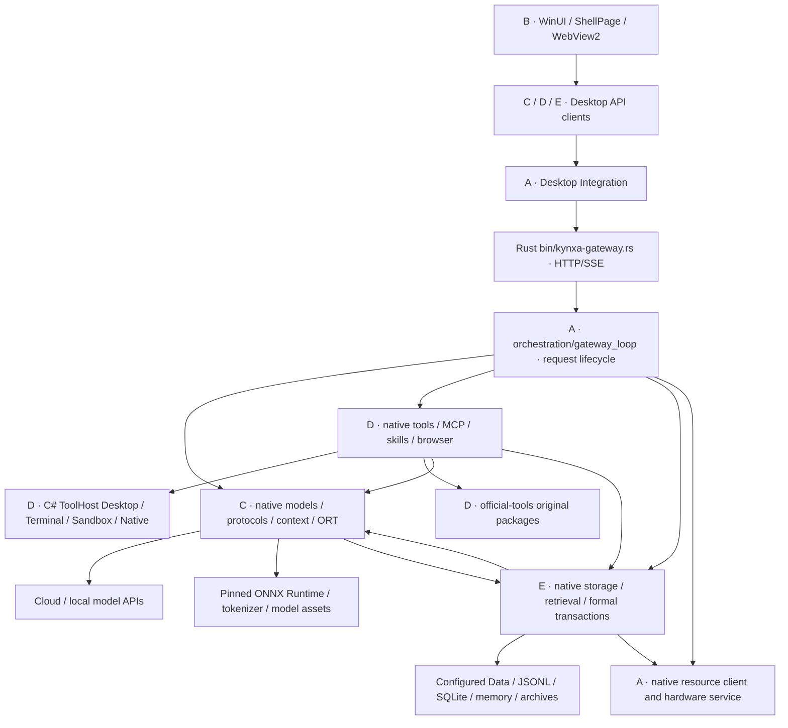

# 五人模块边界与源码参考

更新日期：2026-10-12。五人职责继续保留；当前正式后端为 Windows 原生 Rust 网关，公开 HTTP/SSE 与桌面合同保持兼容。业务与执行接线见 [原生架构](rust-agent-control.md) 和 [团队入口](../team/README.md)。历史 Node 迁移记录仍保留，但不是当前源码入口或本轮验收成绩。

## 实际调用链

图展示实际执行层的主要调用方向，不是纯规则域依赖图。C 的上下文 I/O 读取 E 的核验归档，E 的检索 I/O 调用 C 的推理接口，均按逐文件清单许可；纯规则仍禁止域循环和反向依赖集成层。客户端通过共享 Chat/Tools/Memory DTO 通信，正式会话仍由单网关的队列/事务写入，不等同于历史设计中的独立权限 Authority。

桌面 Services 子目录保留原程序集、命名空间和公开类型；既有客户端对 UiText 等展示类型的引用仍存在。全部 ShellPage partial 共享页面状态，由 B 唯一主责；目录重组不代表完整 MVVM 或跨程序集隔离。

## 主责目录

| 区域 | 主责 | 内容 |
|---|---|---|
| agent-core gateway / 组合 / orchestration | A | `gateway.rs`、`gateway_contract.rs`、`bin/kynxa-gateway.rs`、任务循环、HTTP/SSE、取消、回执/核验和恢复预算 |
| agent-core tools | D | Rust 工具/审批/浏览器/终端作业状态、Skill/配置与受控文件服务；桌面/终端执行事实来自 ToolHost |
| agent-core models | C | 四种协议普通/工具流、供应商 HTTP、配置/观察、上下文/摘要、私有续传核验、固定 ORT/tokenizer 嵌入/重排 |
| agent-core retrieval / storage | E | 检索/分块、证据与记忆状态、正式 JSONL/SQLite/资料事务、页游标/原始 UTF-16/哈希身份、ANN 和有资源授额的后台发布 |
| agent-core resources | A | Rust 兼容资源建议、反馈与推理需求；准入/驻留/外部模型预测协调由业务核心管理，真实硬件采样及总租约仍归独立资源服务 |
| official-tools | D | `apps/official-tools/catalog.json` / `manifest.json`、Skills 与第三方许可证，作为静态资源随包 |
| desktop Services/Integration | A | 网关启动/生命周期、通信与错误基础 |
| desktop Services/Presentation 及 Views/Controls/资源 | B | 展示、交互、本地化与页面接线 |
| desktop Services/Models；shared Chat | C | 模型/聊天 API、SSE、聊天 DTO |
| desktop Services/Tools；shared Tools | D | 能力配置 API 与工具 DTO |
| desktop Services/Data；shared Memory | E | 会话/记忆 API、路径迁移与记忆 DTO |
| tool-host Desktop/Terminal/Sandbox/Native | D | 原生执行；根入口/csproj/构建与打包由 A 协调 |

agent-core、official-tools、desktop、shared、tool-host 位于 apps 下同名目录。桌面 Integration 启动 `runtime/agent/kynxa-gateway.exe`，原生资源位于 `runtime/native`，模型 profile 按既有随包布局定位；初始化使用原生 `--initialize-storage`，开发手动启动见 `tools/development/start-native-gateway.ps1`。不提供 Node/NAPI 回退。检查调用端与 smoke 的 Compile Include，不擅改公开字段、原始身份或资源语义。WebView JavaScript 继续承担界面；Node 架构检查、预览等工具仅用于开发。

## 依赖与共享变更

Rust 纯规则域保持 [主责清单](../team/module-ownership.json) 的 `rustApps[].allowedDomainDependencies`：orchestration → models、tools → models、storage → retrieval；models/retrieval/resources 不新增跨业务域依赖。纯域禁止循环、禁止引用 I/O 集成模块，真实共享身份/取消/传输合同留在已有根模块，不堆入无边界的工具箱。

真实 I/O 层按 `integrationModules` 逐文件声明 `path`、`allowedDomains` 和职责；实际文件、网络、线程、数据库及推理执行按 `executionModules` 登记。`gateway.rs`、模型供应商/压缩 I/O、工具 MCP/浏览器 I/O、存储/索引 I/O 复用纯规则和各域公开服务，其调用不构成纯规则域循环，但也不能全域放行。新增文件不因名称或所在目录自动获许可；纯域若需要读取归档或执行网络操作，应由明确的 I/O 接线调用规则，而非反向导入集成层。

Chat/Tools/Memory 分别由 C/D/E 主责，A 协调版本。跨端改动先列出字段、身份、错误、旧数据默认值和双方调用方，再同步实现、验证与说明。基础合同联系相应领域负责人；跨目录协作注明文件归属、保留已有改动，不使用虚构账号 CODEOWNERS，不增加普通可逆修改审批。

RAG 由 A 的任务循环组合 C 的 `models/gateway_inference.rs`、E 的 `retrieval/` / `storage/` 与 D 的来源/网页服务，B 接设置与引用展示。检索共享 DTO 位于 `apps/shared/Memory/RetrievalApiContracts.cs`，归 E，A 协调跨端兼容。每位成员负责本域测试；检索与 Agent 基准按被测模块归属，不把全队验证都分给 E。

## 当前成果与后续能力

当前根 Rust HTTP 路由调用各领域原生服务，任务循环使用既有控制/证据/资源规则。正式数据仍由单网关写入，稳定 ID、JSONL 原文、catalog 权威、会话队列、确认记忆范围与 expectedRevision 保留。请求上下文、历史摘要、UI 阶段收束和结果预览都是投影，不删除正式事实。任务结果与消息传输终态分开，核验失败/部分/执行未知不能被后续上下文当成功。

原生源码覆盖流式、工具循环、请求权限快照、审批、回执、MCP/Skill、浏览器与 ToolHost，功能是否复现须看本轮实际验证。隔离范围以 [工具架构](agent-tools.md) 为准；会话保存、上下文检查点与取消不能等同于副作用自动安全重放。崩溃后动作核实、幂等恢复和验证版本分别验收，不引用旧 Node 测试数字证明本轮成果，也不预填完成时长。

## 一手源码证据

以下路径核查于 2026-10-05；上游快速变化，使用前重新核对。本轮借鉴职责边界，没有复制第三方源码。

| 项目 | 源码路径证据 | KYNXA 采用的经验 |
|---|---|---|
| DeepSeek Harness | [architecture](https://github.com/deepseek-ai/deepseek-harness/blob/master/docs/architecture.md)、[agent-loop package](https://github.com/deepseek-ai/deepseek-harness/blob/master/packages/core/agent-loop/package.json)；本地源码已读 | agent 接口、loop 实现、tools、llm、session persistence 分开；持久事件与实时投影分开；五人团队不照搬 Cordis 和大量 package |
| pi | [agent-loop](https://github.com/earendil-works/pi/blob/main/packages/agent/src/agent-loop.ts)、[types](https://github.com/earendil-works/pi/blob/main/packages/agent/src/types.ts) | StreamFn 注入、context transform 与模型转换、工具执行钩子分开；旧 badlogic/pi-mono 已重定向 |
| OpenCode | [processor](https://github.com/anomalyco/opencode/blob/dev/packages/opencode/src/session/processor.ts)、[llm](https://github.com/anomalyco/opencode/blob/dev/packages/opencode/src/session/llm.ts)、[tool registry](https://github.com/anomalyco/opencode/blob/dev/packages/opencode/src/tool/registry.ts) | 轮次处理、请求和注册有入口；registry 仍依赖 Session/Provider，不宣称上游完全解耦 |
| OpenClaw | [embedded runner](https://github.com/openclaw/openclaw/blob/main/src/agents/embedded-agent-runner/run.ts)、[plugin loader](https://github.com/openclaw/openclaw/blob/main/src/plugins/loader.ts) | 稳定入口与内部 orchestrator/loader 实现分开；旧 pi-embedded-runner 和 plugin-sdk/index 路径不作当前证据 |
| Codex | [core](https://github.com/openai/codex/blob/main/codex-rs/core/src/lib.rs)、[tool router](https://github.com/openai/codex/blob/main/codex-rs/core/src/tools/router.rs)、[protocol](https://github.com/openai/codex/blob/main/codex-rs/protocol/src/protocol.rs) | 核心/协议/工具合同分开，保持身份与回执；Rust 源码不构成 KYNXA 换语言理由 |

DeepSeek 本地 LICENSE 为 MIT；[pi](https://github.com/earendil-works/pi/blob/main/LICENSE)、[OpenCode](https://github.com/anomalyco/opencode/blob/dev/LICENSE)、[OpenClaw](https://github.com/openclaw/openclaw/blob/main/LICENSE) 为 MIT；[Codex](https://github.com/openai/codex/blob/main/LICENSE) 为 Apache-2.0。后续若复制代码，核对具体文件/依赖并保留对应声明。Claude 私有内部实现没有本轮可核查源码，不作为内部架构证据。
